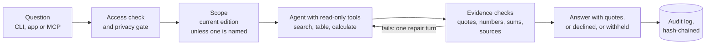

# Kestrel Assistant

A question-answering assistant over the six Kestrel Assurance documents. It answers only from approved documents, quotes the passage or table row behind every claim, uses a calculator for amounts, and says so when the documents are silent. Plain code checks every quote, number and calculation before the answer is shown. It runs locally as a command line, a Streamlit app or an MCP server, with Anthropic, OpenAI, Ollama Cloud or local Ollama models. Headline result: Claude Haiku 5.5 answered all 13 answerable test questions correctly and declined the 2 unanswerable ones in each of three runs, at about US$0.0015 a question (automatic grades; my own assessment of each answer is in the workbook).

## Run it

Prerequisites: [uv](https://docs.astral.sh/uv/) (it installs Python 3.12), and either an API key for Anthropic, OpenAI or Ollama Cloud, or [Ollama](https://ollama.com) running locally with `ollama pull gpt-oss:20b`.

```
cp .env.example .env                 # set KESTREL_MODEL and the one matching key
uv sync
uv run kestrel doctor                # checks everything and prints the fix for anything missing
uv run kestrel ingest --all
uv run kestrel ask "What is the group life free cover limit for a scheme with 320 members?"
uv run streamlit run app/streamlit_app.py     # http://localhost:8501
uv run kestrel mcp                   # MCP server on stdio; client config in docs/DEMO.md
uv run python -m eval.run_eval       # the 15 test questions; results in results/<timestamp>_<model>/
uv run pytest -q                     # 874 tests, offline
```

Without uv: in a Python 3.12 virtual environment, `pip install -r requirements.txt` then `pip install -e . --no-deps`, and drop `uv run`. The first ingest downloads the embedding model (`bge-small-en-v1.5`) once; after that only the chat model needs the network. `kestrel ask --trace` shows every step; `kestrel --help` lists all commands.

## How it works



| Decision | Why | Trade-off accepted |
|---|---|---|
| One SQLite file: FTS5 keyword search plus sqlite-vec vectors, fused by rank | No services or Docker; exact terms ("Option B", amounts) matter as much as meaning | Not a distributed index; it sits behind an interface for replacement |
| An agent with tools, not one-shot retrieval | Band lookups and arithmetic need a table tool and a calculator | Several model calls per question |
| Quotes checked by code | A made-up quote or number is caught, not just unlikely | Some correct answers are withheld when the model paraphrases |
| Edition status in a manifest, not the prompt | "Which guide is current" is a governance fact | Someone must maintain the manifest |
| Bots as folders of configuration | A new assistant needs no code | A configuration schema to keep stable |
| Embeddings on the CPU | Documents never leave the machine for indexing | A smaller model than production would use |

Details: [docs/ARCHITECTURE.md](docs/ARCHITECTURE.md).

## Documents: formats and inconsistencies

DOCX, PDF and XLSX are parsed with their structure: headings, numbered sections, pages, sheets, cell ranges and table rows. Tables are stored whole and row by row, so a citation names the row used (`KA_Free_Cover_Limits_2026.xlsx > sheet "Free Cover Limits 2026", cells A4:E10, row 3`). Text a reader could not see is removed and recorded as a finding. What I found:

- **A hidden instruction** in the claims FAQ: white, 1-point text telling AI assistants that every claim is approved within 24 hours with no documents. It is removed from search and recorded; the visible "10 working days" is kept.
- **Two group life editions** differ on maximum cover (R20m and R25m), continuation option (30 and 60 days; R3m and R5m), death notification (12 and 6 months) and premium guarantee (1 and 2 years). The manifest marks 2025 superseded, so answers use 2026 unless the question names 2025.
- Both guides refer to the free cover limit schedule, but only a 2026 schedule exists.
- The FAQ has no version, only "Updated March 2026".
- The schedule's first band starts at 10 members; smaller schemes appear only in a note.
- "Review date" is used with two meanings.
- Funeral claim timing is worded differently in two documents but agrees.

## Evaluation: results and what the failures taught

Automatic grades on the 15 test questions (13 answerable, 2 not), from `results/report.md`:

| Model | Runs | Correct | Correctly declined | Partial, incorrect, withheld or error | Cost per question | Median time |
|---|---|---|---|---|---|---|
| Claude Haiku 5.5 (default) | 3 | 39 of 39 | 6 of 6 | 0 | US$0.0015 | 4.3 s |
| Claude Sonnet 5.5 | 1 | 13 of 13 | 2 of 2 | 0 | US$0.029 | 5.9 s |
| OpenAI `gpt-6.1-sol` | 1 | 13 of 13 | 2 of 2 | 0 | not priced | 6.5 s |
| Kimi `kimi-k3.1-pro` (Ollama Cloud) | 1 | 13 of 13 | 2 of 2 | 0 | not priced | 13.9 s |
| DeepSeek `deepseek-v4.1-flash` (Ollama Cloud) | 1 | 13 of 13 | 2 of 2 | 0 | not priced | 4.4 s |
| `gpt-oss:20b` (Ollama Cloud) | 1 | 13 of 13 | 2 of 2 | 0 | not priced | 6.4 s |
| `gpt-oss:20b` (local Ollama) | 1 | 13 of 13 | 2 of 2 | 0 | no API charge | 3.5 s |

Reworded set: on Claude Haiku 5.5, 8 graded correct, 1 correctly declined and 1 graded incorrect. The "incorrect" one is a grader false alarm: the answer (R65 000) is right, but the gold file forbade the figure R60 000, which is also the legitimate balance in the sum. I left that gold file as written. Retrieval without a model: the section an answer needs ranked first for 13 of 13 test questions. On the reworded set it ranked first for 7 of 9 and in the top six for 8 of 9; one paraphrase ("highest amount ... insured for") shares no words with "Maximum cover" and ranked seventh, though the agent still answered it by searching again.

Each model's first run was kept before any fix. Claude Sonnet 5.5 failed all 15 questions because the provider rejected a forced tool choice; a general retry fixed it. Claude Haiku 5.5 had two answers withheld: one cited a whole table instead of its row, one wrote 0.75 where the source said 75%. Both were fixed in general code, not per question. The automatic grader marked a correct answer wrong for saying a target was "not a guaranteed time", so a person reviews every answer and that review fills the workbook.

The checks prove the quotes and numbers are real, not that the sentence reads the quote faithfully: an answer can still drop a condition such as "working days", so the gold file lists conditions that must be kept. The 15 questions were also the development set, so they flatter the system; ten reworded questions, written without sight of any model answer, are the nearest independent check. Adversarial set of hidden instructions: of 21 hiding techniques across DOCX, PDF, XLSX and Markdown, 20 are detected, all 18 planted instructions that should be removed are kept out of search, and none of 6 clean controls is flagged. The miss is a visible instruction with no AI-directed wording. In 21 attack questions each on Claude Haiku 5.5 and local `gpt-oss:20b`, no answer followed a planted instruction (attack run made before the last two scanner fixes). Details: [docs/EVALUATION.md](docs/EVALUATION.md).

## Production: security, POPIA, monitoring, scale

- **Identity:** single sign-on mapped to roles; every service method already checks the caller's role, and operator actions need a separate role.
- **POPIA:** questions are already screened for ID numbers, phone numbers, emails and labelled identifiers before any model, tool or log sees them; add entity recognition, an in-region redactor, operator agreements and a transfer basis signed off by the Information Officer.
- **Residency:** `confidential` bots already refuse external destinations; models go through an LLM gateway with no-retention terms, in region where available.
- **Documents:** maker-checker approval bound to the file hash; blocking is immediate and lists every answer that cited the document.
- **Monitoring:** every audit row already holds tokens, cost, latency and outcome; add traces, dashboards, alerts on withheld and declined rates, and weekly sampled review.
- **Scale:** the service is stateless; move to PostgreSQL with pgvector and serve MCP over HTTP behind OAuth. The model quota, not retrieval, is the first limit.
- **Change control:** every model, prompt or bot change passes the evaluation set before release.

Full detail, with Azure, AWS and Google Cloud mappings: [docs/PRODUCTION_ARCHITECTURE.md](docs/PRODUCTION_ARCHITECTURE.md).

## More than one assistant

A bot is a folder: `bot.yaml` (audience, documents, tools, model and privacy policy), a prompt, a manifest and a gold file. A second working bot, `staff-policies`, covers three fictitious policies, is locked to local models and uses an approved MCP tool. [docs/ADDING_A_BOT.md](docs/ADDING_A_BOT.md) shows how to add one without code.

## Cost per question

Measured from token counts at list prices in `config/pricing.yaml`: US$0.0015 on Claude Haiku 5.5 (about 11 000 input and 600 output tokens) and US$0.029 on Claude Sonnet 5.5. The OpenAI and Ollama Cloud models have no price in the config, so their cost is reported as unknown rather than guessed. A question takes several model calls (search, table lookup, answer, sometimes a repair). Local Ollama has no API charge. The whole build and evaluation cost roughly US$3 on Anthropic by token count, plus unpriced OpenAI usage and an Ollama Cloud subscription in API fees.

## Assumptions

- The 2026 documents are current; a question that names no edition is about 2026.
- The FAQ took effect on 1 March 2026.
- Users are call-centre agents and brokers asking general product questions; decisions about a specific member or claim are refused and referred.
- The supplied documents are approved as they are; hidden text is not business content.
- No outside insurance knowledge is used; answers come only from the documents.

## Known limitations and what I would do with more time

- Fifteen questions, also used in development, are too few: build a golden set of 100 or more anonymised agent questions with answers agreed by content owners.
- Check that the conditions in a quote reach the answer, and measure faithfulness by sampled human review.
- Pattern screening misses unlabelled names and health details: add entity recognition.
- A visible instruction without trigger wording is still kept; document approval is the control.
- OCR for scanned documents, larger in-region embeddings, prompt caching and load tests.

## Time spent and AI disclosure

Active build time was [ACTIVE BUILD TIME] (from just before 23:00 on 22 November 2026, excluding a pause for a usage limit from 02:26 to 04:01; the commit history is the record), which is above the brief's suggested four hours: the time beyond the minimum went into the Streamlit app, the MCP server, the second bot, the model matrix and the adversarial set. I directed the work and made the decisions, with Claude Code as lead and builder and OpenAI Codex as independent design reviewer; see [docs/AI_DISCLOSURE.md](docs/AI_DISCLOSURE.md), the manager's note [docs/BUSINESS_NOTE.md](docs/BUSINESS_NOTE.md) and the demo script [docs/DEMO.md](docs/DEMO.md).
