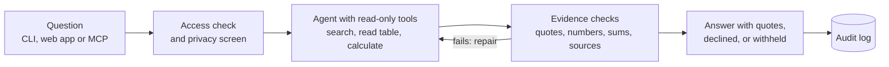

# Kestrel Assistant

This is a question-answering assistant for Kestrel Assurance call-centre agents and brokers. It answers only from the six supplied documents, quotes the passage or table row behind each claim, and says so when the documents do not cover a question.

On the final code, six of the eight models I tested answered all 13 answerable questions correctly and declined the 2 unanswerable ones in each of three runs. The default, Claude Haiku 5.5, costs about US$0.0015 a question and takes about 4 seconds. The completed workbook is [results/KA_Test_Questions_SUBMISSION.xlsx](results/KA_Test_Questions_SUBMISSION.xlsx).

## The approach

Two ideas shaped the design.

The first is that I trust neither the model nor the documents without a check. The model writes a readable answer, but every citation has to carry a word-for-word quote. Plain code then confirms that the quote exists in an approved, current document, that each number in the answer comes from a cited passage, and that every sum is right. An answer that fails is repaired once or withheld; it is never shown as fact. The documents get the same treatment: ingestion looks for text a reader cannot see, and one of the six does hide an instruction aimed at AI assistants.

The second is that an assistant should be configuration, not code. A business that proves this on product guides will want an internal policies assistant next, and an IT help desk after that. I did not want each one to be a new project, so the core knows nothing about insurance. Each assistant is a folder that declares its documents, prompt, tools, MCP servers, skills, allowed models and privacy rules. The repository has two: `kestrel-products`, which is the one assessed here, and `staff-policies`, a small demonstration locked to on-device models. Adding a third needs no code: [docs/ADDING_A_BOT.md](docs/ADDING_A_BOT.md).



## Run it

Install [uv](https://docs.astral.sh/uv/) (installs Python 3.12). Supply an Anthropic, OpenAI or Ollama Cloud API key, or run [Ollama](https://ollama.com) locally with `ollama pull gpt-oss:20b`.

```
cp .env.example .env                 # set KESTREL_MODEL and the matching key
uv sync
uv run kestrel doctor                # checks the setup and prints the fix for anything missing
uv run kestrel ingest --all
uv run kestrel ask "What is the group life free cover limit for a scheme with 320 members?"
uv run streamlit run app/streamlit_app.py     # web app at http://localhost:8501
uv run kestrel mcp                   # MCP server (client config in docs/DEMO.md)
uv run python -m eval.run_eval       # the 15 test questions, results in results/
uv run pytest -q                     # 993 tests, offline
```

Without uv, use a Python 3.12 virtual environment: `pip install -r requirements.txt`, then `pip install -e . --no-deps`; omit `uv run`. Ingest downloads the embedding model once. `kestrel ask --trace` shows each step.

## Key decisions

| Decision | Why | Trade-off |
|---|---|---|
| One SQLite file: keyword search (FTS5) plus vectors (sqlite-vec), fused by rank | Runs anywhere with no services; exact terms like "Option B" and amounts matter as much as meaning | Not a distributed index; it sits behind an interface |
| An agent with tools, not one-shot retrieval | Band lookups and arithmetic need a table reader and a calculator | Two to four model calls per question |
| Quotes and numbers checked by code | A made-up quote or figure is caught, not just unlikely | A correct answer is sometimes withheld |
| Which edition is current is recorded in a manifest | It is a governance fact, not something a model should guess | Someone must maintain the manifest |
| LangChain DeepAgents | One agent runs on four providers, with skills and MCP support | A framework dependency to pin |
| Embeddings on the CPU | Documents never leave the machine for indexing | A smaller model than production would use |

More: [docs/ARCHITECTURE.md](docs/ARCHITECTURE.md).

## Document formats and inconsistencies

I parse DOCX, PDF and XLSX with their structure intact, so a citation can name the section, page or spreadsheet row, for example `KA_Free_Cover_Limits_2026.xlsx > sheet "Free Cover Limits 2026", cells A4:E10, row 4 (cells A8:E8)`. Tables are stored whole and row by row.

The claims FAQ contains a hidden instruction: white, 1-point text telling AI assistants that every claim is approved within 24 hours with no documents. Ingestion removes it from search and records it as a finding, and keeps the visible "10 working days" beside it.

The two editions of the group life guide disagree on four things: maximum cover (R20m in 2025, R25m in 2026), the continuation option (30 days and R3m, against 60 days and R5m), death notification (12 months against 6) and the premium guarantee (1 year against 2). A manifest marks 2025 as superseded, so answers use 2026 unless the question names the 2025 edition. Smaller points: the free cover schedule exists only for 2026, the FAQ carries no version, and "review date" is used with two meanings.

## Evaluation

I ran each model on the 15 questions three times (13 answerable, 2 not). Grades are automatic; I read every answer not graded correct.

| Model | Correct | Correctly declined | Other | Needed a repair | Cost per question | Median time |
|---|---|---|---|---|---|---|
| Claude Haiku 5.5 (default) | 39 of 39 | 6 of 6 | 0 | 1 | US$0.0015 | 3.9 s |
| Claude Sonnet 5.5 | 39 of 39 | 6 of 6 | 0 | 3 | US$0.027 | 4.6 s |
| OpenAI `gpt-6.1-sol` | 39 of 39 | 6 of 6 | 0 | 3 | US$0.016 | 6.0 s |
| Kimi `kimi-k3.1-pro` (Ollama Cloud) | 39 of 39 | 6 of 6 | 0 | 0 | US$0.025 | 6.9 s |
| `gpt-oss:20b` (Ollama Cloud) | 39 of 39 | 6 of 6 | 0 | 0 | US$0.0009 | 7.0 s |
| `gpt-oss:20b` (local Ollama) | 39 of 39 | 6 of 6 | 0 | 0 | no API charge | 5.7 s |
| DeepSeek `deepseek-v4.1-flash` (Ollama Cloud) | 37 of 39 | 6 of 6 | 1 partial, 1 graded incorrect | 1 | US$0.0033 | 2.7 s |
| GLM `glm-5.3-flash` (Ollama Cloud) | 37 of 39 | 6 of 6 | 2 graded incorrect | 1 | US$0.0017 | 3.5 s |

No answer was withheld or errored. I do not recommend DeepSeek or GLM: DeepSeek dropped the condition "before normal retirement age" from one answer, and the three answers graded incorrect gave the right figure but added a neighbouring one the question did not ask for. "Needed a repair" counts answers whose first draft failed a check and was corrected. The workbook comes from one further Haiku run on the final commit: 13 correct, 2 correctly declined. All runs are in [results/report.md](results/report.md).

What the failures taught me:

- **A clean score can hide a weakness.** Two questions passed only because a repair turn rescued a wrong first draft every time; the model was misreading which band of a table a number fell in. When a repair failed, the answer was withheld. The table tool now finds the matching row in code, and I track repairs per model.
- **First runs are worth keeping.** One model failed all 15 questions because its provider rejected a setting, and another had two answers withheld. The fixes went into general code, never a rule for one question.
- **The grader is not the judge.** It marked a correct answer wrong three times, so I assessed every answer myself and that assessment fills the workbook.
- **The checks prove evidence, not interpretation.** An answer can quote the right passage and still drop a condition such as "working days", so the gold answers list the conditions that must be kept.
- **These 15 questions flatter the system**, because I also developed against them. Ten reworded questions, written without sight of any answer, scored 8 correct, 1 correctly declined and 1 incorrect (a grader false alarm: R65 000 is right). Search alone ranked the needed section first for 13 of 13 supplied questions but only 7 of 9 reworded ones.

An independent code review after the build found ten defects, all fixed with tests. Of 21 ways of hiding an instruction in a document, the scanner detects 20, and no answer followed a planted instruction. Details: [docs/EVALUATION.md](docs/EVALUATION.md).

## Production: security, POPIA, monitoring, scale

I would map single sign-on to existing per-call role checks. Questions are screened for ID numbers, phones, emails and labelled identifiers before models, tools or logs see them. Production needs entity recognition, operator agreements and Information Officer sign-off: patterns miss personal information.

`confidential` bots already reject off-device models and tools. Production adds a gateway and regional endpoints where available. Document approval binds to hashes; blocking immediately excludes a document and lists affected answers.

The tamper-evident audit records outcomes, tokens, cost and latency. Add dashboards, withheld/declined-rate alerts and sampled human review. The stateless service can scale over managed database and search services, with authenticated HTTP for MCP. Azure, AWS and Google Cloud designs: [docs/PRODUCTION_ARCHITECTURE.md](docs/PRODUCTION_ARCHITECTURE.md).

## Cost per question

A question on the default model, Claude Haiku 5.5, costs about **US$0.0015**: roughly 12 000 input and 600 output tokens over two or three model calls. The table above gives the figure for each model, from US$0.0009 on `gpt-oss:20b` to US$0.027 on Claude Sonnet 5.5. These are measured token counts at the providers' list prices on 23 November 2026 (`config/pricing.yaml` names the sources), without caching discounts, so they are upper estimates. Local Ollama has no API charge. Building and evaluating this cost roughly US$6 in Anthropic fees by token count, plus smaller OpenAI and Ollama Cloud usage.

## Assumptions

I default to current 2026 documents. Users ask general product questions; member or claim decisions are refused and referred. Hidden text is excluded from business content, and no outside insurance knowledge is used.

## What I would do with more time

- Agree answers to 100 or more real agent questions with content owners.
- Review sampled answers for dropped conditions; one model lost one in testing.
- Detect names and health details missed by patterns, and visible instructions without tell-tale wording (currently controlled only by approval).
- Improve reworded-question retrieval with larger embeddings and a reranker; add OCR, caching and load tests.

See also: [business note](docs/BUSINESS_NOTE.md) · [AI tool disclosure](docs/AI_DISCLOSURE.md) · [demo script](docs/DEMO.md)
