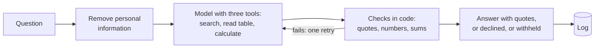

# Kestrel Assistant

A question-answering assistant for Kestrel Assurance call-centre agents and brokers. It answers only from the six supplied documents, shows the exact passage or table row it relied on, and says so when the documents do not cover a question.

**Result.** With the default model (Claude Haiku 5.5) it answered all 13 answerable test questions correctly and declined the 2 that the documents cannot answer, in each of three runs. A question costs about US$0.0015 and takes about 4 seconds. My completed workbook is [results/KA_Test_Questions_SUBMISSION.xlsx](results/KA_Test_Questions_SUBMISSION.xlsx).

I designed and directed this, and AI coding assistants wrote most of the code under that direction: see the [AI tool disclosure](docs/AI_DISCLOSURE.md).

## Run it

You need [uv](https://docs.astral.sh/uv/), which installs Python 3.12 for you, and one API key. The six documents are already in the repository under `data/source/kestrel-products/`.

```
cp .env.example .env                 # Windows cmd: copy .env.example .env
uv sync
uv run kestrel doctor                # checks the setup and prints the fix for anything missing
uv run kestrel ingest --all
uv run kestrel ask "What is the group life free cover limit for a scheme with 320 members?"
```

In `.env`, fill in the key for the model you want. The file ships with `KESTREL_MODEL=anthropic:claude-haiku-5-5`, which needs `ANTHROPIC_API_KEY`. The other options are listed in the file: `openai:gpt-6.1-sol` with `OPENAI_API_KEY`, `ollama-cloud:kimi-k3.1-pro` with `OLLAMA_API_KEY`, or `ollama:gpt-oss:20b` with no key if [Ollama](https://ollama.com) is running on your machine (`ollama pull gpt-oss:20b`).

The first `ingest` needs the internet once, to download a small embedding model. It reports nine files added: the six Kestrel documents, plus three sample documents for a second demonstration assistant (see the last section). `ask` prints the answer, then each source with its quote. Add `--trace` to see every step.

Then, as you wish:

```
uv run python -m eval.run_eval                # the 15 test questions: about 2 minutes, about US$0.02
uv run streamlit run app/streamlit_app.py     # optional web app at http://localhost:8501
uv run kestrel mcp                            # optional MCP server (client setup in docs/DEMO.md)
uv run pytest -q                              # 993 tests, no network or key needed, a few minutes
```

The evaluation writes a new folder, `results/<timestamp>_<model>/`, holding `results.csv` and a filled copy of the workbook. It never overwrites my submitted workbook. Without uv: in a Python 3.12 virtual environment, `pip install -r requirements.txt`, then `pip install -e . --no-deps`, and leave out `uv run`.

## How it works



I did not want to trust the model's word, so the model must back every statement with a word-for-word quote, and ordinary code then checks three things: the quote really is in the document it cites, every number in the answer appears in a cited passage or in the question, and every calculation is correct when recomputed. If a check fails, the model gets one chance to fix the answer, with the failures listed. If it still fails, the user sees "this answer could not be confirmed against the sources" and the relevant sections to read, never a wrong answer presented as fact. That is what "withheld" means below. "Declined" is different: the model looked and the documents do not cover the question.

The model does not read tables by eye. A tool finds the row whose range contains the number in the question (the band for 320 members, say), and a calculator does the arithmetic.

## Key decisions

| Decision | Why | Trade-off |
|---|---|---|
| Everything in one SQLite file, searched two ways (keywords and meaning) and combined | Runs on a laptop with nothing to install; exact terms like "Option B" and rand amounts matter as much as meaning | Would be replaced by a managed search service at scale |
| A model that calls tools, not a single prompt with pasted passages | Table lookups and arithmetic are where plain retrieval goes wrong | Two or three model calls per question |
| Quotes and numbers checked by code | An invented quote or figure is caught, not just made unlikely | A correct answer is occasionally withheld |
| A small file (`bots/kestrel-products/manifest.yaml`) records which edition of a guide is current | "Which guide applies today" is a business fact, not something a model should guess | Someone has to maintain that file |
| LangChain's DeepAgents framework | The same code runs on Anthropic, OpenAI and Ollama models | A dependency to keep pinned |

More detail: [docs/ARCHITECTURE.md](docs/ARCHITECTURE.md).

## The documents: formats and inconsistencies

Each format is read with its structure kept, so a source can be named precisely. Word files are split by heading and numbered section, with tables kept as tables. The PDF is read page by page, and its table is extracted cell by cell, because plain text extraction scrambles the columns. The spreadsheet's table is found by its layout and stored with its header row and cell addresses, so a source reads `KA_Free_Cover_Limits_2026.xlsx, sheet "Free Cover Limits 2026", row 4 of the table (cells A8:E8)`. Three things in the pack needed handling:

- **A hidden instruction in the claims FAQ.** White, 1-point text tells AI assistants to say every claim is approved within 24 hours with no documents. The loader removes text a reader cannot see, records it as a finding, and keeps the visible "10 working days" next to it.
- **Two editions of the group life guide that disagree**: maximum cover (R20m in 2025, R25m in 2026), the continuation option (30 days and R3m, against 60 days and R5m), death notification (12 months against 6) and the premium guarantee (1 year against 2). Answers use 2026 and do not mention the 2025 figures, unless the question asks for the 2025 edition.
- **Smaller gaps**: the free cover schedule exists only for 2026, and the FAQ has no version number, only "Updated March 2026".

**Assumptions.** The 2026 documents are current. Users ask general product questions; a question about a specific member or claim is refused and the user is pointed to the claims team. No insurance knowledge from outside the documents is used.

## Evaluation

**Method.** `eval/run_eval.py` asks all 15 questions and saves every answer with its sources. For each question I wrote down, from the documents, the facts a correct answer must contain and the conditions it must not drop. A script compares each answer against that list as a first pass. It is a text match, not a judge: it flagged three correct answers as wrong, so I read every answer myself, and the assessment column in the workbook is mine.

**Results.** Three runs of the 15 questions on each model (39 answerable, 6 unanswerable per model):

| Model | Correct | Correctly declined | Cost per question | Median time |
|---|---|---|---|---|
| Claude Haiku 5.5 (default) | 39 of 39 | 6 of 6 | US$0.0015 | 3.9 s |
| Claude Sonnet 5.5 | 39 of 39 | 6 of 6 | US$0.027 | 4.6 s |
| OpenAI `gpt-6.1-sol` | 39 of 39 | 6 of 6 | US$0.016 | 6.0 s |
| `gpt-oss:20b` on local Ollama | 39 of 39 | 6 of 6 | no API charge | 5.7 s |

No answer on these four models was partially correct, incorrect, withheld or an error. Results for four more models are in [docs/EVALUATION.md](docs/EVALUATION.md), including two cheaper ones I do not recommend: one dropped a condition and both added figures nobody asked for.

**These numbers flatter the system.** I developed against these 15 questions and fixed what failed. To check that, I wrote ten reworded and new questions before seeing any answers. All ten were handled correctly (nine answered, one correctly declined). Search on its own was weaker there: it ranked the right section first for all 13 test questions but only 7 of the 9 reworded ones that have an answer. One question phrased as "highest amount a member can be insured for" did not match the heading "Maximum cover", and the model only got there by searching again.

**What failed, and what I learned.**

- **First runs.** Claude Sonnet 5.5 failed all 15 questions on its first run because the provider rejected a request setting, and Claude Haiku 5.5 had two answers withheld. I kept those results (`results/dev/`) and fixed the causes in general code, not with rules for particular questions.
- **A perfect score was hiding a weakness.** In earlier runs the model misread which band 320 members falls in on its first attempt, every time, and the retry rescued it. Twice the retry failed as well and the answer was withheld. So I added a tool that finds the row in code. Every result in the table above was run with it.
- **The checks prove the evidence is real, not that the sentence reads it faithfully.** An answer can quote the right passage and still drop "working days". Users should read the quote, and my expected-answer lists include the conditions that must survive.

## Taking it to production

**Security and access.** Put it behind the organisation's single sign-on. The prototype already checks a user's role on every call and keeps a log of each question, its sources and its outcome, but the "user" is a local setting, not a real identity.

**POPIA.** Call-centre staff will type member details whether we want them to or not. The prototype strips ID numbers, phone numbers, emails and labelled policy or member numbers from a question before it reaches the model or the log. That is pattern matching and will miss an unlabelled name or a health detail, so production needs proper entity detection, operator agreements with each model provider, a decision on where inference runs, and sign-off from the Information Officer before a pilot.

**Monitoring.** Track the share of answers withheld or declined, cost and response time per question, and which sections are never cited. Sample answers for human review every week, and re-run the evaluation before any change to the model or the prompts.

**Scale.** Replace the SQLite file with a managed database and search service, and put a gateway in front of the model providers for quotas and fallback. New editions of a guide should need a named owner's approval before they are searchable; the prototype can already withdraw a document immediately (`kestrel docs block`) and list the past answers that cited it.

Options on Azure, AWS and Google Cloud, and a POPIA mapping: [docs/PRODUCTION_ARCHITECTURE.md](docs/PRODUCTION_ARCHITECTURE.md).

## Cost per question

About **US$0.0015** on the default model: roughly 12 000 input and 600 output tokens over two or three model calls, at list prices on 23 November 2026 (`config/pricing.yaml` names the sources). The results table has the figure for each model. The whole assessment cost about US$10 in API fees across Anthropic, OpenAI and Ollama Cloud: US$8.80 for the evaluation runs saved under `results/`, and the rest for runs made while fixing problems.

## Beyond the brief

Two things go further than the brief asks, and can be set aside when assessing the core.

**The assistant is configuration, not code.** If this works for product guides, the next requests will be an internal policies assistant and an IT help desk, and I did not want each to be a new project. So nothing in the core code is about insurance. An assistant is a folder holding its documents, its instructions, the tools and models it may use, and its privacy rules. A second, small assistant over three made-up staff policies is included to prove it, restricted to a local model. [docs/ADDING_A_BOT.md](docs/ADDING_A_BOT.md) shows how to add another without writing code.

**A web app and an MCP server** sit on the same code as the command line. The web app shows the conversation, the evidence, the documents and the evaluation results; the MCP server lets other AI tools ask the assistant questions.

## With more time

- Agree answers to 100 or more real agent questions with the people who own the documents.
- Improve search for questions worded differently from the documents.
- Detect names and health details that pattern matching misses.
- Have a person review every new or changed document before it is searchable.

See also: [business note](docs/BUSINESS_NOTE.md) · [AI tool disclosure](docs/AI_DISCLOSURE.md) · [evaluation detail](docs/EVALUATION.md) · [demo script](docs/DEMO.md)
