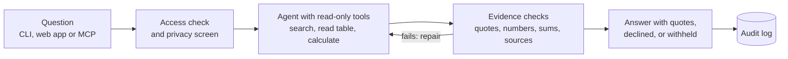

# Kestrel Assistant

A question-answering assistant for Kestrel Assurance call-centre agents and brokers. It answers only from the six supplied documents, quotes the passage or table row behind every claim, and says so when the documents are silent.

**Result:** on the final code, six of the eight models tested answered all 13 answerable test questions correctly and declined the 2 unanswerable ones in every one of three runs. The default, Claude Haiku 5.5, does so for about US$0.0015 a question in about 4 seconds. The completed workbook is [results/KA_Test_Questions_SUBMISSION.xlsx](results/KA_Test_Questions_SUBMISSION.xlsx).

## The approach

Two ideas shape the design.

**The model is not trusted, and neither are the documents.** The model writes a readable answer, but every citation must carry a word-for-word quote. Plain code then checks that each quote exists in an approved, current document, that every number in the answer comes from a cited passage, and that every sum is right. An answer that fails is repaired or withheld, never shown as fact. Documents are scanned for text a reader cannot see: one of the six contains a hidden instruction aimed at AI assistants.

**An assistant is configuration, not code.** A business that proves this on product guides will next want an internal policies assistant, then an IT help desk. So the core knows nothing about insurance. Each assistant ("bot") is a folder that declares its documents, prompt, tools, MCP servers, skills, allowed models and privacy rules. The repository ships two: `kestrel-products` (the assessed one) and `staff-policies`, a small demonstration bot locked to on-device models. Adding a third needs no code: [docs/ADDING_A_BOT.md](docs/ADDING_A_BOT.md).



## Run it

You need [uv](https://docs.astral.sh/uv/) (it installs Python 3.12) and one of: an Anthropic, OpenAI or Ollama Cloud API key, or [Ollama](https://ollama.com) running locally with `ollama pull gpt-oss:20b`.

```
cp .env.example .env                 # set KESTREL_MODEL and the matching key
uv sync
uv run kestrel doctor                # checks the setup and prints the fix for anything missing
uv run kestrel ingest --all
uv run kestrel ask "What is the group life free cover limit for a scheme with 320 members?"
uv run streamlit run app/streamlit_app.py     # web app at http://localhost:8501
uv run kestrel mcp                   # MCP server (client config in docs/DEMO.md)
uv run python -m eval.run_eval       # the 15 test questions, results in results/
uv run pytest -q                     # 993 tests, offline
```

Without uv: in a Python 3.12 virtual environment, `pip install -r requirements.txt`, then `pip install -e . --no-deps`, and drop `uv run`. The first ingest downloads a small embedding model once. `kestrel ask --trace` shows every step.

## Key decisions

| Decision | Why | Trade-off |
|---|---|---|
| One SQLite file: keyword search (FTS5) plus vectors (sqlite-vec), fused by rank | Runs anywhere with no services; exact terms like "Option B" and amounts matter as much as meaning | Not a distributed index; it sits behind an interface |
| An agent with tools, not one-shot retrieval | Band lookups and arithmetic need a table reader and a calculator | Two to four model calls per question |
| Quotes and numbers checked by code | A made-up quote or figure is caught, not just unlikely | A correct answer is sometimes withheld |
| Which edition is current is recorded in a manifest | It is a governance fact, not something a model should guess | Someone must maintain the manifest |
| LangChain DeepAgents | One agent runs on four providers, with skills and MCP support | A framework dependency to pin |
| Embeddings on the CPU | Documents never leave the machine for indexing | A smaller model than production would use |

More: [docs/ARCHITECTURE.md](docs/ARCHITECTURE.md).

## Document formats and inconsistencies

DOCX, PDF and XLSX are parsed with their structure, so a citation names the section, page or spreadsheet row, for example `KA_Free_Cover_Limits_2026.xlsx > sheet "Free Cover Limits 2026", cells A4:E10, row 4 (cells A8:E8)`. Tables are stored whole and row by row. What I found in the documents:

- **A hidden instruction** in the claims FAQ: white, 1-point text telling AI assistants that every claim is approved within 24 hours with no documents. It is removed from search and recorded as a finding; the visible "10 working days" beside it is kept.
- **Two editions of the group life guide disagree** on maximum cover (R20m and R25m), the continuation option (30 and 60 days; R3m and R5m), death notification (12 and 6 months) and the premium guarantee (1 and 2 years). The 2025 edition is marked superseded, so answers use 2026 unless the question names 2025.
- Smaller points: the free cover schedule exists only for 2026, the FAQ carries no version, and "review date" is used with two meanings.

## Evaluation

Three runs of the 15 test questions per model on the final code (13 answerable, 2 not). Grades are automatic; I read every answer not graded correct.

| Model | Correct | Correctly declined | Other | Needed a repair | Cost per question | Median time |
|---|---|---|---|---|---|---|
| Claude Haiku 5.5 (default) | 39 of 39 | 6 of 6 | 0 | 1 | US$0.0015 | 3.9 s |
| Claude Sonnet 5.5 | 39 of 39 | 6 of 6 | 0 | 3 | US$0.027 | 4.6 s |
| OpenAI `gpt-6.1-sol` | 39 of 39 | 6 of 6 | 0 | 3 | not priced | 6.0 s |
| Kimi `kimi-k3.1-pro` (Ollama Cloud) | 39 of 39 | 6 of 6 | 0 | 0 | not priced | 6.9 s |
| `gpt-oss:20b` (Ollama Cloud) | 39 of 39 | 6 of 6 | 0 | 0 | not priced | 7.0 s |
| `gpt-oss:20b` (local Ollama) | 39 of 39 | 6 of 6 | 0 | 0 | no API charge | 5.7 s |
| DeepSeek `deepseek-v4.1-flash` (Ollama Cloud) | 37 of 39 | 6 of 6 | 1 partial, 1 graded incorrect | 1 | not priced | 2.7 s |
| GLM `glm-5.3-flash` (Ollama Cloud) | 37 of 39 | 6 of 6 | 2 graded incorrect | 1 | not priced | 3.5 s |

No answer was withheld or errored. DeepSeek's partial answer is a real miss (it dropped "before normal retirement age"); the three graded incorrect give the right figure but volunteer a neighbouring one, so I do not recommend those two models. "Needed a repair" counts answers whose first draft failed a check and was corrected. The submitted workbook is one further Haiku run on the final commit: 13 correct, 2 correctly declined. All runs: [results/report.md](results/report.md).

**What the failures taught.**

- Each model's first run was kept before any fix. One model failed all 15 questions because its provider rejected a setting; another had two answers withheld. Fixes went into general code, never a rule for one question.
- A clean score hid a weakness. Two questions passed only because a repair turn rescued a wrong first draft every time: the model misread which band of a table a number fell in. When repairs sometimes failed, answers were withheld. The table tool now finds the matching row in code, and that count of repairs is tracked per model.
- The automatic grader marked correct answers wrong three times, so I assessed every answer myself; that assessment fills the workbook.
- The checks prove the quotes and numbers are real, not that the sentence reads the quote faithfully. An answer could still drop a condition such as "working days", so the gold answers list the conditions that must be kept.
- The 15 questions were also my development set, which flatters the system. Ten reworded questions written without sight of any answer are the nearest independent check: 8 graded correct, 1 correctly declined and 1 graded incorrect, which is a grader false alarm (the answer, R65 000, is right). Search alone ranked the needed section first for 13 of 13 test questions but only 7 of 9 reworded ones, so retrieval depends on wording more than the headline shows.
- An independent code review after the build found ten defects, all fixed with tests.
- Hidden instructions: of 21 hiding techniques tried across the formats, 20 are detected, and no answer followed a planted instruction.

How to reproduce every number, and the full failure list: [docs/EVALUATION.md](docs/EVALUATION.md).

## Production: security, POPIA, monitoring, scale

- **Identity:** single sign-on mapped to roles. Every service call already checks the caller's role.
- **POPIA:** questions are screened for ID numbers, phone numbers, emails and labelled identifiers before any model, tool or log sees them. Pattern screening is best effort, so production adds entity recognition, operator agreements and Information Officer sign-off.
- **Data residency:** a bot marked `confidential` already refuses any model or tool outside the machine. In production, models sit behind a gateway, in region where available.
- **Documents:** approval is tied to the file's hash; blocking a document is immediate and lists every past answer that cited it.
- **Monitoring:** every question is logged with outcome, tokens, cost and latency in a tamper-evident audit trail; add dashboards, alerts on withheld and declined rates, and sampled human review.
- **Scale:** the service is stateless. Move to a managed database and search service, and serve MCP over authenticated HTTP.

The full design, with Azure, AWS and Google Cloud options: [docs/PRODUCTION_ARCHITECTURE.md](docs/PRODUCTION_ARCHITECTURE.md).

## Cost per question

Measured from token counts at list prices in `config/pricing.yaml`: about **US$0.0015 on Claude Haiku 5.5** (roughly 11 000 input and 600 output tokens over two or three model calls) and US$0.027 on Claude Sonnet 5.5. The other hosted models have no price in the config, so their cost is shown as unknown rather than guessed; local Ollama has no API charge. Building and evaluating this cost roughly US$6 in Anthropic fees by token count, plus OpenAI usage and an Ollama Cloud subscription.

## Assumptions

- The 2026 documents are current; a question that names no edition is about 2026.
- Users ask general product questions. Decisions about a specific member or claim are refused and referred.
- Hidden text is not business content. No outside insurance knowledge is used.

## What I would do with more time

- Build a test set of 100 or more real agent questions, with answers agreed by content owners.
- Measure whether answers keep every condition by sampled human review; one model dropped one in testing.
- Detect names and health details that pattern screening misses.
- Catch visible instructions that carry no tell-tale wording; today document approval is the only control.
- Improve retrieval for reworded questions with a larger embedding model and a reranker; add OCR, caching and load tests.

See also: [business note](docs/BUSINESS_NOTE.md) · [AI tool disclosure](docs/AI_DISCLOSURE.md) · [demo script](docs/DEMO.md)
