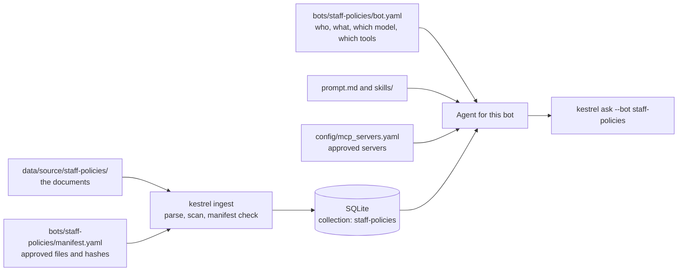

# Adding a bot

To add a bot, create its configuration and document folders. The core needs no code changes. Follow the supplied `staff-policies` bot here; its three Kestrel Assurance staff policies are fictitious.



## 1. Create the folders

```
bots/staff-policies/            bot.yaml, prompt.md, manifest.yaml, skills/, eval/gold.yaml
data/source/staff-policies/     the documents (DOCX, PDF, XLSX or Markdown)
```

Use the same lower-case, hyphenated name for the bot id, folder and `id:` field.

## 2. Drop in the documents

Put files in `data/source/<collection>/`. Headings and numbered sections supply citation locations, such as `section 2 "Annual leave", table 1`, so use clear headings. Tables are stored whole and by row; the assistant can then cite the row it used.

## 3. Write `bot.yaml`

| Field | What it does | `staff-policies` |
|---|---|---|
| `id`, `name`, `description` | Identity shown in every front end | `staff-policies`, "Staff Policy Helper" |
| `audience` | Roles allowed to see and use the bot; checked on every call | `[staff]` |
| `knowledge.collections` | The only documents the bot can search (filtered in SQL) | `[staff-policies]` |
| `knowledge.approval` | `required`: a file is searchable only if listed in the manifest with its hash. `none`: every file is searchable | `required` |
| `prompt` | Persona and domain guidance, appended to the shared core rules | `prompt.md` |
| `tools` | Built-in read-only tools: `search_documents`, `get_table`, `calculate` | all three |
| `mcp_servers` | Names of centrally approved servers from `config/mcp_servers.yaml` | `[workday-calendar]` |
| `skills` | Folders holding `<skill>/SKILL.md` procedures, read-only | `[skills/]` |
| `model.default` | `<provider>:<model>`; `${KESTREL_MODEL}` uses the global setting | `ollama:gpt-oss:20b` |
| `model.allowed_providers` | Providers this bot may send text to | `[ollama]` |
| `model.max_model_calls`, `max_searches`, `timeout_s` | Budget per question | 12, 6, 300 s |
| `privacy.classification` | `confidential` allows on-device destinations only (models and MCP servers) | `confidential` |
| `privacy.on_personal_information` | `redact` replaces personal details; `block` refuses the question | `block` |
| `privacy.audit_question_text` | `redacted` stores the screened question; `none` stores only a digest | `none` |
| `privacy.retention_days` | Audit rows older than this are pruned | 30 |
| `verification.on_failure` | `withhold` hides an answer that fails the evidence checks; `warn` shows it with a warning | `withhold` |
| `evaluation.gold` | Gold answers for `eval.run_eval` | `eval/gold.yaml` |

An unknown field causes a load error naming that field, so a typo is visible immediately. (There is no `examples:` field.)

## 4. Approve the documents

When using `approval: required`, list each file in `manifest.yaml` with its SHA-256, family, edition and effective date. Any change to its bytes invalidates approval: it becomes `pending` until re-approved. Compute the hash with:

```
uv run python -c "import hashlib,sys;print(hashlib.sha256(open(sys.argv[1],'rb').read()).hexdigest())" data/source/staff-policies/KA_Staff_Leave_Policy.md
```

Use `approval: none` only for scratch or test bots: it skips the human approval step.

## 5. Optional: skills and MCP servers

Write a skill in `bots/<id>/skills/<skill-name>/SKILL.md`. Its front matter needs a `name` matching the folder name and a one-line `description`. The staff bot's `leave-entitlement` skill explains how to select a leave-table band. A skill guides the agent; it cannot serve as evidence.

Before a bot can use an MCP server, a person must approve it in `config/mcp_servers.yaml`, recording its command, allowed tools, `on-device` or `external` location and a read-only statement. The bot opts in by name. A `confidential` bot refuses an `external` server.

## 6. Ingest and ask

```
uv run kestrel ingest --bot staff-policies
uv run kestrel ask --bot staff-policies "How many days of annual leave does an employee with 7 completed years of service get?"
```

Ingest reports each file's status (`current`, `pending`, `blocked`) and any hidden-text findings.

## 7. Evaluate

Use the product bot's format to write `eval/gold.yaml`: expected status, facts, conditions, forbidden statements and expected source. Run it with:

```
uv run python -m eval.run_eval --bot staff-policies --set reworded --gold bots/staff-policies/eval/gold.yaml --models ollama:gpt-oss:20b
```

## Things to know

- A full date ("11 March 2026") or a bare year in a question is read as ordinary content when every document family in the bot's collections has one edition, as in `staff-policies`. Once a family has two approved editions, such a question gets a request to clarify whether it means an edition; say "as of 2026-03-11" or "under the 2026 edition" to choose one.
- A result from an approved MCP tool is labelled `t1`, `t2`, ... and can be cited like an excerpt: its quote must be word for word and its numbers (for example a working-day count) then count as evidence. The policy rule itself still needs a citation of a document excerpt.
- Operator actions (ingest, block, unblock, audit verify and prune) need the separate `operator` role. No bot audience, including `staff`, grants them.
