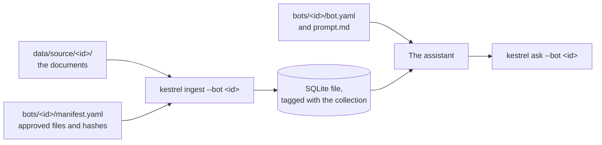

# Adding an assistant

An assistant is a folder of configuration plus a folder of documents; adding one needs no code. The code calls an assistant a *bot*, hence `bots/` and `--bot`. The included `staff-policies` assistant, over three made-up staff policies, is the worked example: open its files beside this page.



## Steps

1. **Pick an id**: lower-case words joined by hyphens, such as `it-helpdesk`. Use it for the folder `bots/<id>/`, the `id:` field and, normally, the collection name.

2. **Add the documents** to `data/source/<collection>/` (Word, PDF, Excel or Markdown). Clear headings and numbered sections give clear citations, such as `section 2 "Annual leave", table 1`.

3. **Approve them** in `bots/<id>/manifest.yaml`, one entry per file (copy `bots/staff-policies/manifest.yaml`). Each entry needs `filename`, `sha256`, `label` (the title shown in citations), `family` (the same for every edition of one document), `edition`, `effective_from`, `approved: true` and `approved_by`; add `supersedes: "<edition>"` when a file replaces an earlier edition. Compute the hash of the file exactly as it is on disk:

   ```
   uv run python -c "import hashlib,sys;print(hashlib.sha256(open(sys.argv[1],'rb').read()).hexdigest())" data/source/<collection>/<file>
   ```

   Any later change to the file's bytes, including line endings, makes it `pending` (not searched) until you update the hash.

4. **Write `bots/<id>/prompt.md`**: a few lines on who the users are and what the assistant covers. It is added after the shared rules, which already require quotes and declines.

5. **Write `bots/<id>/bot.yaml`**. The minimum is:

   ```yaml
   id: it-helpdesk
   name: IT Help Desk
   audience: [staff]
   knowledge:
     collections: [it-helpdesk]
   prompt: prompt.md
   model:
     default: ${KESTREL_MODEL}
   ```

   `audience` must include one of your roles in `KESTREL_ROLES` (`.env.example` gives `call-centre-agent,broker,staff,operator`), or you will be refused.

6. **Ingest and test.** Ingesting needs the `operator` role.

   ```
   uv run kestrel ingest --bot it-helpdesk
   uv run kestrel search --bot it-helpdesk "replacement laptop"
   uv run kestrel ask --bot it-helpdesk "How long does a password reset link last?"
   ```

   Ingest lists each file with its status; anything other than `current` gives the reason. `search` shows what the assistant can find without calling a model. To confirm isolation, search the product assistant for the same words (`uv run kestrel search --bot kestrel-products "replacement laptop"`): none of the new documents appear.

## Every field of `bot.yaml`

Required fields are marked. Any field not in this table is rejected with an error naming it.

| Field | What it does | Default | `staff-policies` |
|---|---|---|---|
| `id` (required) | Must equal the folder name | | `staff-policies` |
| `name` (required) | Shown in every front end | | `Staff Policy Helper` |
| `description` | One line shown in lists | empty | one line |
| `audience` (required) | Roles allowed to use the assistant, checked on every call | | `[staff]` |
| `knowledge.collections` (required) | The only document collections it can search | | `[staff-policies]` |
| `knowledge.approval` | `required`: only files approved in the manifest are searched. `none`: every file is, with no approval step (for scratch assistants only) | `required` | `required` |
| `knowledge.manifest` | Path of the approved-document list, inside the folder | `manifest.yaml` | `manifest.yaml` |
| `knowledge.default_scope` | Only `current` is accepted: older editions are searched only when a question names one | `current` | `current` |
| `prompt` (required) | The instructions file, inside the folder | | `prompt.md` |
| `tools` | Which of `search_documents`, `get_table`, `calculate` the model gets | all three | all three |
| `mcp_servers` | Names of approved servers from `config/mcp_servers.yaml` | none | `[workday-calendar]` |
| `skills` | Folders holding `<skill>/SKILL.md` procedures the model may read | none | `[skills/]` |
| `model.default` (required) | `<provider>:<model>`; `${KESTREL_MODEL}` uses the `.env` setting | | `ollama:gpt-oss:20b` |
| `model.allowed_providers` | Providers it may send text to: `ollama`, `ollama-cloud`, `anthropic`, `openai` | all four | `[ollama]` |
| `model.max_model_calls` | Model calls per question, including the retry (1 to 100) | 12 | 12 |
| `model.max_searches` | Searches per question (1 to 50) | 6 | 6 |
| `model.timeout_s` | Seconds per question | `KESTREL_TIMEOUT_S` (120) | 300 |
| `privacy.classification` | `confidential` allows only on-device models and MCP servers; `public` and `internal` behave the same | `internal` | `confidential` |
| `privacy.on_personal_information` | `redact` replaces personal details with placeholders; `block` refuses the question | `redact` | `block` |
| `privacy.extra_patterns` | Extra screening patterns, each a `kind` label and a regular expression `pattern` | none | none |
| `privacy.audit_question_text` | `redacted` stores the screened question in the audit log; `none` stores only a digest | `none` | `none` |
| `privacy.retention_days` | Age at which `kestrel audit prune` removes audit rows (1 to 3650) | 30 | 30 |
| `verification.on_failure` | `withhold` hides an answer that fails the checks; `warn` shows it with the failures | `withhold` | `withhold` |
| `verification.max_repairs` | Retries allowed when the checks fail (0 to 3) | 1 | 1 |
| `evaluation.gold` | The expected-answer file for the evaluation runner | none | `eval/gold.yaml` |
| `examples` | Up to six example questions of at most 120 characters, shown as buttons in the web app and by `kestrel bots --examples` | none | none (`kestrel-products` has four) |

## Optional extras

- **A skill** is `bots/<id>/skills/<name>/SKILL.md`: front matter with `name` and a one-line `description`, then a short procedure. The model reads it when relevant; it is guidance and cannot be cited. See `staff-policies/skills/leave-entitlement/`.
- **An MCP server** (a separate program offering tools to the model) must first be approved by a person in `config/mcp_servers.yaml`, with its command, allowed tools, `on-device` or `external` location, and a statement that the tools only read. The assistant then lists it by name. A `confidential` assistant refuses an `external` one. The model may cite a tool result, but the rule itself must still be cited from a document.
- **An evaluation**: write `bots/<id>/eval/gold.yaml` in the same format as the staff example (expected status, facts that must appear, statements that must not, expected source), then run `uv run python -m eval.run_eval --bot <id> --questions bots/<id>/eval/gold.yaml`.

## Things to know

- One invalid `bot.yaml` stops `kestrel bots` and the web app's assistant list until it is fixed, so a mistake is never silently skipped.
- A year or date in a question is ordinary text unless some document family in the assistant's collections has two approved editions; then the assistant asks whether an edition is meant.
- To withdraw a document at once: `uv run kestrel docs block <document-id> --reason "..."`. It stays blocked across ingests until `kestrel docs unblock`.
