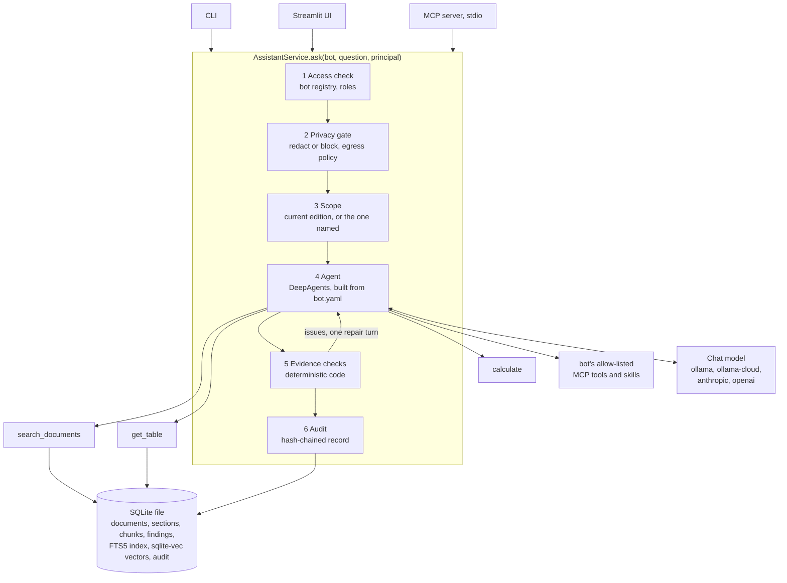
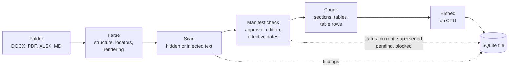
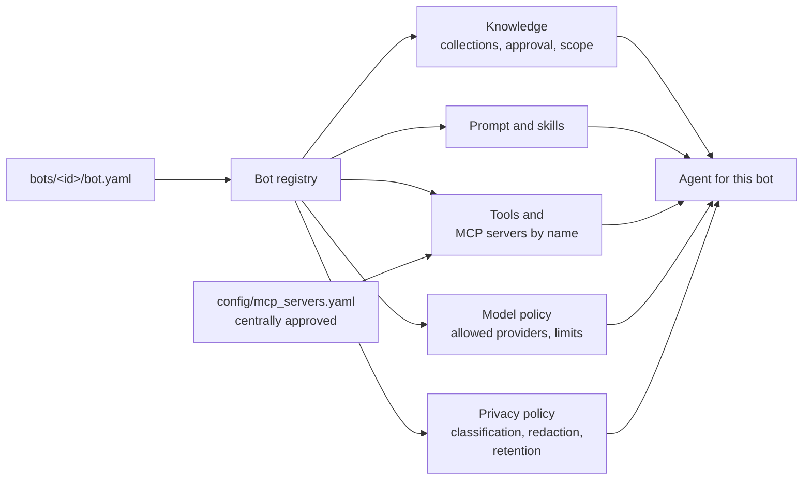

# Kestrel Assistant: architecture

This document describes the system as built. The plan it was built from is [IMPLEMENTATION_PLAN.md](IMPLEMENTATION_PLAN.md); how it would run in production is [PRODUCTION_ARCHITECTURE.md](PRODUCTION_ARCHITECTURE.md).

## 1. Goals

The brief asks for a prototype that ingests six documents in three formats, answers only from them, cites document and section, declines when the documents are silent, runs locally, and comes with an honest evaluation and a production story.

The system meets that with one extra idea: **the assistant is a small governed platform, and Kestrel product Q&A is its first bot.** A second bot is a new folder of configuration and documents, not new code. The repository ships a working second bot, `staff-policies`, to show it.

Design goals, in priority order:

1. **Runs from a few commands** on a laptop: no Docker, no services, one `.env`.
2. **Answers a call-centre agent can read out**, each claim backed by a quote that the application has checked against the source.
3. **The model is not trusted.** Documents are not trusted either. Both are checked by deterministic code.
4. **Privacy by default** (POPIA): personal information is removed from the question before any model, tool, log or store sees it, and a bot's data classification limits where text may be sent.
5. **Bots are configuration.** Knowledge, prompt, tools, MCP servers, skills, model policy and privacy policy are declared per bot.
6. **Provider-neutral.** Local Ollama, Ollama Cloud, Anthropic and OpenAI are selected by one setting.
7. **Small enough to change live.** One service entry point; every front end is a thin adapter.

Out of scope for the prototype: authentication, multi-user concurrency at scale, Postgres, a vector server, OCR. These are covered in [PRODUCTION_ARCHITECTURE.md](PRODUCTION_ARCHITECTURE.md).

## 2. Shape of the system

**Answering a question**



**Ingesting documents**



**How a bot is assembled**



### Module layout

```
src/kestrel/
  contracts/          shared Pydantic models and Protocols, one module per area (answers, documents,
                      retrieval, bots, audit, evaluation, editions, service); import from kestrel.contracts
  config.py           settings from .env
  errors.py           KestrelError and its user-safe categories
  editions.py         deterministic comparison of two editions of a document (no model)
  service/            AssistantService, the only entry point used by front ends:
                      ask.py (the question path), answering.py (agent, checks, repair), documents.py
                      (search, sections, ingest, block), editions.py, doctor.py, runtime.py (shared parts)
  bots/               bot.yaml loader with ${ENV} expansion, MCP server list, registry
  ingest/             parsers/ (docx, pdf, xlsx, markdown), scan/ (visibility, instructions,
                      bidirectional text), manifest, chunker, pipeline
  store/              SQLite schema, document repository, eligibility filter, audit log, vector index
  retrieval/          embeddings, hybrid search, edition and date scope
  llm/                provider:model resolution, tested-model catalogue, pricing, egress policy
  privacy/            redaction rules and the screen
  agent/              agent builder, read-only backend, tools, calculator, MCP tool loader,
                      prompt, budget and retry middleware, runner
  verify/             deterministic evidence checks, quote and number matching
  interfaces/         cli.py (+ cli_admin, cli_render, cli_runtime), mcp_server.py (+ admission, models)
app/streamlit_app.py  Streamlit entry point; app/kestrel_app/ helpers, app/views/ pages
bots/<bot-id>/        bot.yaml, prompt.md, manifest.yaml, skills/, eval/gold.yaml
data/source/<collection>/
eval/                 evaluation runner, grading, human review, workbook, adversarial set
tests/
```

Rule: front ends (`interfaces/` and `app/`) reach the application only through `AssistantService`, using the contracts, the error types and the settings. Nothing under `src/kestrel/` mentions insurance, Kestrel products or any document by name; `tests/test_domain_neutral.py` enforces this.

## 3. Bots as configuration

```yaml
# bots/kestrel-products/bot.yaml
id: kestrel-products
name: Kestrel Product Assistant
description: Answers questions about group life, disability and funeral cover from approved guides.
audience: [call-centre-agent, broker]          # roles allowed to use this bot

knowledge:
  collections: [kestrel-products]              # the only documents this bot can search
  approval: required                           # a document must be listed in manifest.yaml
  default_scope: current                       # superseded editions only on explicit request

prompt: prompt.md                              # persona and domain guidance
tools: [search_documents, get_table, calculate]
mcp_servers: []                                # names from config/mcp_servers.yaml
skills: []                                     # skills/ exists; switched off (see below)

model:
  default: ${KESTREL_MODEL}
  allowed_providers: [ollama, ollama-cloud, anthropic, openai]
  max_model_calls: 12
  max_searches: 6

privacy:
  classification: internal                     # confidential => on-device destinations only
  on_personal_information: redact              # or: block
  audit_question_text: redacted                # or: none
  retention_days: 30

verification:
  on_failure: withhold                         # or: warn
  max_repairs: 1
evaluation:
  gold: eval/gold.yaml
examples:                                      # up to six, shown as buttons in the app
  - What is the maximum group life cover per member?
```

What this buys:

- **Isolation.** A collection id is stamped on every document, chunk and vector. Search always filters by the bot's collections in SQL, before ranking. A bot cannot retrieve another bot's documents, and `tests/test_isolation.py` proves it.
- **Least privilege.** A bot gets only the tools, MCP servers and skills it names. MCP servers are defined once in `config/mcp_servers.yaml` (command or URL, allowed tool names, whether it runs on-device or externally, and a reviewer's statement that the listed tools only read). A server is approved centrally and bots opt in by name. An allow-list limits which tools can be called; it cannot make a tool harmless, which is why approval is a human step. Every argument sent to an MCP tool passes the privacy screen first, and the result is wrapped as untrusted data, exactly like a document excerpt.
- **Skills.** Procedural know-how (how to read a banded table, how to handle two editions) lives in `SKILL.md` files loaded through DeepAgents' skills support with a read-only backend rooted at the bot's folder. The agent has no write, shell or sub-agent tools; tests assert both the tool inventory and that paths outside the skills folder cannot be read. The product bot ships two skills but has them **switched off**: measured on the test questions they changed no grade and added about a third more input tokens. The staff bot keeps its `leave-entitlement` skill.
- **Per-bot policy.** A bot over internal policies can be `confidential` and therefore locked to on-device models, while the product bot uses a hosted model.

The repository ships two bots: `kestrel-products` (the assessed one) and `staff-policies`, a small demonstration bot over three clearly labelled fictitious policy documents. It is `confidential`, allows only local Ollama, blocks (rather than redacts) questions with personal details, keeps only a digest of each question in the audit log, and uses an on-device MCP server, `workday-calendar`, from `examples/mcp_servers/`. The 15-question evaluation uses only `kestrel-products` and only the supplied documents. [ADDING_A_BOT.md](ADDING_A_BOT.md) walks through the staff bot field by field.

## 4. Ingestion

- **Parsers keep structure and rendering.** DOCX: heading tree from styles, numbered sections, tables, run formatting resolved through the style chain. PDF: page, headings, tables rebuilt cell by cell from positioned text. XLSX: every sheet, table regions found by layout, header row, cell addresses. Markdown: headings, pipe tables, HTML comments kept as hidden spans. Every text span keeps what is needed to judge visibility (colour, size, hidden flags, position, background).
- **Scanner.** Text a reader could not see (too little contrast, tiny font, hidden runs, invisible render mode, off-page, covered by a shape drawn over it, Unicode tag characters, text reversed by bidirectional controls) is removed from searchable content and recorded as a finding. Contrast is judged against the resolved background, including table-cell shading, so white header text on a dark cell is kept while white text on a white page is not. Wording addressed to an AI assistant is flagged, in hidden and visible text. The rules are generic; none names a document.
- **Citations.** Each section stores a human locator: `file > section 4.2 "heading"`, `file > page 3 > table`, `file > sheet "name", cells A4:E10, row 3`.
- **Tables.** A table is stored whole as structured rows and also chunked row by row with its header, so a search hit can lead to the full table and a citation can name one row.
- **Lifecycle in data, not in the prompt.** `manifest.yaml` binds each file's SHA-256 to a family, edition, effective date, what it supersedes and an approval. Ingest marks each document `current`, `superseded`, `pending` or `blocked`. Only `current` documents are searched by default. A changed file no longer matches its approved hash and drops to `pending`.
- **Idempotent.** Re-running ingest changes nothing unless files or the manifest changed.

## 5. Retrieval

Hybrid search inside one SQLite file: FTS5 (BM25) for exact terms such as "Option B" or amounts, and `sqlite-vec` cosine search over `bge-small-en-v1.5` embeddings computed on CPU with fastembed. Results are fused by reciprocal rank. Collection, status and edition filters are applied inside the SQL of both rankers, before ranking, by one eligibility function.

Why this choice: zero extra services, all three front ends can read the file at once (WAL, one short-lived connection per operation), documents never leave the machine for indexing, and exact-term recall matters as much as meaning in rule documents. The vector index sits behind a `VectorIndex` protocol, so a managed search service replaces it without touching callers. If the vector extension cannot load, search falls back to keywords only and `kestrel doctor` says so.

Superseded editions are invisible by default. A question that names one edition or one date ("under the 2025 guide", "as of 2025-06-01") *switches* the scope to the edition in force then; it never mixes two editions in one result set. A question that names two editions gets a request to ask about one at a time. A bare year that could be an event date or an edition gets a request to clarify, but only when some document family in the bot's collections has more than one approved edition; otherwise the year is ordinary content. Blocked and pending documents are never searchable, whatever the scope.

Comparing editions is done by code, not by the model: `kestrel docs compare` and the Documents page align sections by heading and list the values that changed.

## 6. Answering

A DeepAgents agent, restricted to read-only tools, returns a structured answer:

```
status        answered | partial | not_found | refused
answer        short, plain language, suitable to read to a caller
citations     [{label: "c3", "c7.r4" or "t1", quote: "<verbatim text>", supports: "<the claim it backs>"}]
calculations  [{expression, result, rule: "<label of the excerpt stating the formula>"}]
caveats       conflicts, assumptions, limits
reason        required for not_found and refused
```

Tools: `search_documents` (labelled excerpts `c1, c2, ...`, with a search budget and duplicate guard; a whole-table hit is shown as labelled rows), `get_table` (every row of the table an excerpt belongs to, each row labelled `c7.r1, c7.r2, ...` with its header, for band lookups) and `calculate` (a safe decimal arithmetic evaluator with defined rounding; the model never does sums itself). Results of a bot's approved MCP tools are labelled `t1, t2, ...`.

The prompt requires the answer to carry the conditions attached to a rule (for example "the lower of", "aims to", "working days", "after receipt of all documents") and to quote them. It separates a decision about an actual person or claim (refused, with who to ask) from a question with example figures (answered as an illustration of the rule).

**Requirements by status**

| Status | Meaning | Must have |
|---|---|---|
| `answered`, `partial` | the documents support the answer | at least one citation; every check below passes |
| `not_found` | the documents do not establish an answer | a reason worded as "the documents do not say", never as a fact about the business; citations optional |
| `refused` | outside the bot's purpose or privacy policy | a reason and who to ask |

Two further outcomes are set by the application, not the model: `withheld` (evidence checks failed after repair) and `error`. All six are reported separately in the audit trail and in evaluation, so a retrieval miss, a correct decline and a withheld answer are never counted as the same thing.

**Evidence checks** run after the model and are plain code (`verify/checks.py`). Each issue is reported under its check name:

1. `label_retrieved`: every cited label was actually shown to the model in this request;
2. `quote_verbatim`: every quote is found verbatim in the excerpt, row or tool result it cites (after whitespace, punctuation and number-format normalisation; an ellipsis may skip words);
3. `table_row_cited`: a citation into a table names a row, not the whole table, so the quote must come from the row relied on;
4. `numbers_grounded`: every number in the answer and caveats appears in a cited excerpt or tool result, the question, or a recomputed calculation (digits, grouped digits, "R5 million", number words, and a percentage's fraction such as 75% and 0.75 are normalised);
5. `calculation_recomputed`: every reported calculation is recomputed, each operand is traced to a cited source or the question, and the calculation names the excerpt that states the rule;
6. `decline_reason`: a decline carries a reason and does not follow hidden arithmetic;
7. `source_status`: no citation points at a superseded, pending or blocked document unless the question asked for that edition.

A `schema` check comes first: `answered` and `partial` need answer text and at least one citation.

**Tool results as evidence.** A result from an approved MCP tool (for example a working-day count) can be cited by its `t` label. Its quote must be verbatim and its numbers then count as evidence, also as calculation operands. A tool result is not a document, so an answer that cites only tool results is accepted only when it reports the facts the tool returned; any rule or condition still needs a citation of a document excerpt.

On failure the agent gets one repair turn with the specific issues. If it still fails, the bot's policy decides: `withhold` (the user sees "could not confirm against the sources", with the retrieved sections to read) or `warn`. Issues fixed by the repair stay in the report as warnings. The outcome is always shown and always audited, together with the steps taken (privacy gate, scope, each tool call, checks, repair).

**What the checks do and do not prove.** They prove the evidence exists, is quoted exactly, comes from an approved current source, and that the arithmetic is right. They do not prove the sentence is a faithful reading of the quote: an answer can cite the right passage and still drop a condition, or pick the right table but argue from the wrong rule. Every front end therefore says "evidence checks passed", never "verified", and shows the quotes beside the answer. Faithfulness is measured in evaluation (section 10) and, in production, by sampled human review. Fully deterministic validation of free prose is out of scope.

This gives readable answers with checkable evidence: the model writes the sentence, the application proves the quote and the numbers, and a person can confirm the reading at a glance.

## 7. Privacy and security

**Privacy gate, before anything else.** A question is normalised and screened for South African ID numbers (date and checksum validated), phone numbers, emails, labelled bank, card, policy and reference numbers, labelled names and dates of birth, plus patterns a bot adds under `privacy.extra_patterns`. Per bot policy the text is redacted or the request is blocked. The model, MCP tools, the audit log and the UI history receive only the screened text. If screening fails, the request fails closed.

Pattern screening is best effort. It will miss an unlabelled name or a free-text description of someone's health, so it reduces exposure rather than guaranteeing none. That residual risk is why the audit log keeps only a digest of the question unless a bot opts in to storing the screened text with a retention period, and why production adds entity recognition and an in-region redactor. The gate screens what users type; source documents are assumed to be approved business content and are checked for hidden text, not for personal information.

**Egress policy.** Every destination that could receive text is tagged `on-device` or `external`: model providers, MCP servers, and the Ollama endpoint (on-device only when its host is loopback). A `confidential` bot refuses any external destination; the check runs when the bot is loaded and again per request, before any text is sent. Base URLs and keys are passed explicitly, so provider environment variables cannot redirect traffic past the policy. Framework tracing to third-party services is switched off in code. The Streamlit app listens on localhost only.

Keeping data on the device is one control, not POPIA compliance. Operator agreements, cross-border transfer safeguards, retention and deletion duties, and breach handling are organisational, and are set out condition by condition in [PRODUCTION_ARCHITECTURE.md](PRODUCTION_ARCHITECTURE.md).

**Purpose limits.** The assistant gives general product information. It refuses member-specific decisions (will this claim be paid, is this person covered) and says who to ask.

**Untrusted content.** Documents and MCP tool output are data. Hidden text is stripped at ingest, excerpts and tool results are wrapped with a data-only notice, the agent has no tools with side effects, and the evidence checks limit what an injected instruction could achieve to text that must still be quoted from an approved source.

**Audit.** One append-only, hash-chained table: bot, channel, principal, screened question or its digest, retrieved excerpts, citations, calculations, outcome and its reason, steps, model, tokens, cost, latency. Retention is per bot; pruning writes a checkpoint row that carries the chain forward. `kestrel audit verify` detects an edited or deleted row. This is limited tamper evidence: someone with write access to the file could rebuild the whole chain, so production anchors the chain head in a separate write-once store. `kestrel docs affected` lists every past answer that cited a document, which is what an operator needs after blocking one.

**Access.** Every service call carries a `Principal` (user, roles, channel), and the role check applies to every method, not only `ask`: search, section lookup, document listing and audit reads are all scoped to bots the principal may use. Operator actions (ingest, block, unblock, audit verify and prune) also need the separate `operator` role, so no bot audience grants them. The MCP server does not expose operator actions at all. The prototype takes the principal from `KESTREL_USER` and `KESTREL_ROLES`; production maps it from single sign-on. The seam is real, the identity provider is not.

**Secrets.** Keys only in `.env`, never logged, `.env` ignored by git; `kestrel doctor` reports which keys are present without printing them.

## 8. Models and configuration

One setting selects the model: `KESTREL_MODEL=<provider>:<model>`, overridable per command with `--model`.

| Provider prefix | Runs where | Needs |
|---|---|---|
| `ollama` | this machine | Ollama running, model pulled |
| `ollama-cloud` | Ollama Cloud | `OLLAMA_API_KEY` |
| `anthropic` | Anthropic API | `ANTHROPIC_API_KEY` |
| `openai` | OpenAI API | `OPENAI_API_KEY` |

Resolution goes through LangChain chat models, so adding Azure OpenAI, Bedrock or Vertex is a mapping entry, not a new client.

Tool calling and structured output vary by model, not just by provider. `config/models.yaml` names the models the answers were evaluated with: `claude-haiku-5-5` and `claude-sonnet-5-5` (Anthropic), `gpt-6.1-sol` (OpenAI), `kimi-k3.1-pro`, `deepseek-v4.1-flash` and `gpt-oss:20b` (Ollama Cloud), and `gpt-oss:20b` (local Ollama). The answer is returned through a tool call. Some providers reject a forced tool choice, so the call is retried once with an automatic choice and the model remembered; an answer a model writes as JSON text is accepted if it validates, and still goes through every check. One budget per question covers model calls, searches, repairs and wall-clock time. An untested model works if it supports tool calling; `kestrel doctor` says whether the configured model is on the tested list.

The service API is synchronous. It runs the agent on an event loop it owns, so Streamlit reruns and the MCP server's own loop never share loop-bound clients. Token usage is read from each response and priced from `config/pricing.yaml`, giving a measured cost per question; a model without a price is reported as unknown, never as zero. `kestrel doctor` checks the environment end to end and prints the exact fix for anything missing.

## 9. Seams for scale

Each is a `Protocol` in `kestrel.contracts` with one local implementation:

| Seam | Prototype | Production direction |
|---|---|---|
| `DocumentRepository`, `AuditLog` | SQLite | managed relational database |
| `VectorIndex` | sqlite-vec | managed hybrid search service |
| `Embedder` | fastembed on CPU | larger multilingual model, in region |
| chat model | LangChain provider | LLM gateway with routing, quotas, fallback |
| `PrivacyScreen` | rules | rules plus NER plus in-region redactor |
| `Principal` source | local settings | single sign-on and group mapping |
| bot registry | folders in git | reviewed config repo or admin service |
| MCP server | stdio | streamable HTTP behind OAuth |

[PRODUCTION_ARCHITECTURE.md](PRODUCTION_ARCHITECTURE.md) maps each seam to Azure, AWS and Google Cloud services and covers residency, POPIA conditions, monitoring, cost and rollout.

## 10. Evaluation

Details and commands are in [EVALUATION.md](EVALUATION.md).

- `eval/run_eval.py` runs the 15 questions through `AssistantService` for one or more models and runs, and writes a CSV, a JSONL trace, a summary, a review file and a filled copy of `KA_Test_Questions.xlsx`. A search-only pass measures where the expected section ranks without any model.
- Automatic grading against a gold file is kept separate from the human assessment column; both are reported.
- The gold file holds, per question: the expected status, the facts that must appear, the **conditions that must not be dropped** (for example "lower of", "working days", "accidental death is covered immediately"), statements that must not appear, and the section that should be cited. This is where answer faithfulness is measured.
- Outcomes are counted separately: correct, partially correct, incorrect, correctly declined, incorrectly declined, withheld by the evidence checks, error, and retrieval miss (the gold section was never retrieved).
- A set of ten reworded questions, written without sight of any model answer, is the nearest thing to an independent check, since the 15 questions were also the development set.
- An adversarial set of 21 fixtures with hidden instructions measures the scanner and whether a model follows a planted instruction.

## 11. Decisions and trade-offs

| Decision | Why | Cost accepted |
|---|---|---|
| SQLite + FTS5 + sqlite-vec in one file | runs anywhere, one thing to back up, concurrent readers | not a distributed index; replaced behind the seam |
| Agent with tools, not single-shot RAG | band lookups and arithmetic need tools | several model calls per answer |
| Quote-backed citations and code checks | hallucination becomes detectable, not just unlikely | some good answers are withheld when a quote is paraphrased |
| Edition status in a manifest | "which guide is current" is a governance fact, not a model guess | someone must maintain the manifest |
| Bots as folders of YAML | new use cases without code; reviewable in git | a schema to keep stable |
| Local CPU embeddings | documents stay on the machine; free | smaller model than production would use |
| DeepAgents on LangChain | one agent runtime across four providers, skills and MCP support | a framework dependency to pin |
| Product-bot skills off | no measured gain on the test questions | the know-how lives in the prompt instead |
