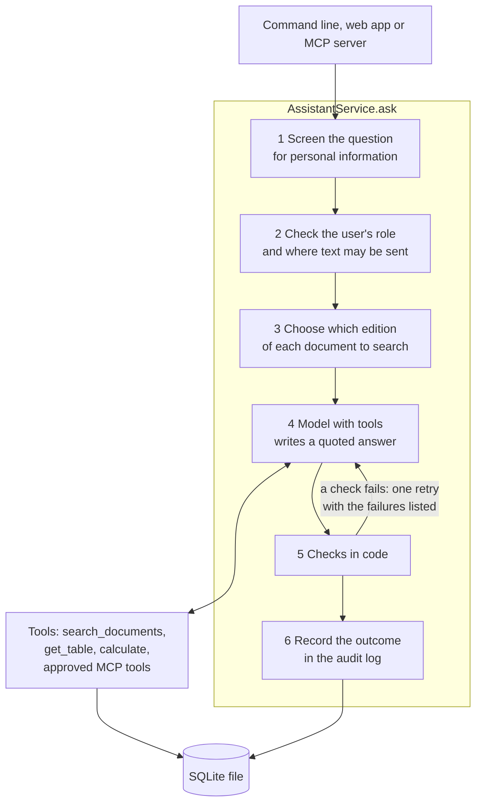
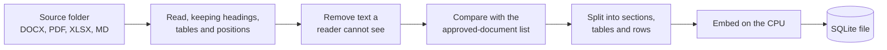

# Kestrel Assistant: architecture

How the prototype is built and why. It assumes you have read the [README](../README.md); the proposed production setup is in [PRODUCTION_ARCHITECTURE.md](PRODUCTION_ARCHITECTURE.md).

## 1. What the system is

A Python application that answers questions from a fixed set of documents. It reads the documents once into a single SQLite file on the laptop ("ingestion"). For each question, a language model searches that file through tools I wrote and drafts an answer with word-for-word quotes; ordinary code then checks the quotes, numbers and sums before anything is shown.

The code calls a configured assistant a *bot*, so that word appears in file names and commands. One assistant covers the six Kestrel documents. A second, small one over three made-up staff policies shows that a new assistant needs configuration, not code (section 8).

Every question ends in one of six outcomes, counted separately in the log, the web app and the evaluation:

| Outcome | Meaning |
|---|---|
| `answered`, `partial` | The documents answer all or part of the question |
| `not_found` | The documents do not say (the README calls this *declined*) |
| `refused` | A decision about a specific person or claim, or stopped by the role or privacy rules |
| `withheld` | The checks still failed after one retry, so the answer is not shown |
| `error` | Something failed, such as the model provider being unreachable |

## 2. Where things live

| Folder | What it does |
|---|---|
| `src/kestrel/service/` | `AssistantService`, the single entry point for every front end |
| `src/kestrel/ingest/` | Format readers, the hidden-text scanner, edition and approval rules |
| `src/kestrel/store/` | SQLite storage, the search filter, the audit log |
| `src/kestrel/retrieval/` | Embeddings, combined search, reading editions and dates from a question |
| `src/kestrel/agent/` | The model's tools, the calculator, the table-range lookup, the core prompt |
| `src/kestrel/verify/` | The checks on an answer |
| `src/kestrel/privacy/` | The personal-information screen |
| `src/kestrel/llm/` | Model clients, tested models, prices, rules on where text may be sent |
| `src/kestrel/bots/`, `contracts/` | Loading each assistant's folder; shared data types and interfaces |
| `src/kestrel/interfaces/`, `app/` | The command line and MCP server; the Streamlit web app |
| `bots/<id>/`, `config/` | One folder per assistant; model, price and MCP server settings |
| `eval/` | The evaluation runner, grading, the workbook writer |

The command line, web app and MCP server only parse input and format output; everything else happens in `AssistantService`, so a behaviour change is made once. Nothing under `src/kestrel/` names insurance, Kestrel or a document; `tests/test_domain_neutral.py` fails if it does.

## 3. Ingestion

`kestrel ingest` reads each assistant's documents from `data/source/<collection>/`. A *collection* is a named set of documents; an assistant lists the collections it may search.

The README describes how each format is read. Every reader keeps headings, pages, tables and cell addresses, so a citation names a place a person can find, and tables are stored whole and row by row, so an answer can cite one row.

**Hidden text.** The scanner removes text a reader could not see: marked hidden, under 3 points, off the page or under a shape, too little contrast against its actual background (table shading included), invisible Unicode characters, or reversed by direction-control characters. Each removal is recorded as a *finding* (`kestrel docs findings`). Wording aimed at an AI ("ignore previous instructions") is flagged too, and kept for review if visible. The rules look only at how text is rendered, never at which document it is in.

**Editions and approval.** Each assistant has a `manifest.yaml`, its list of approved documents. An entry binds a file's SHA-256 hash (a fingerprint of its exact bytes) to a family (the editions of one guide), an edition label, an effective date, the edition it replaces, and who approved it. Ingestion gives each file a status:

- `current`: approved and in force. Only these are searched by default.
- `superseded`: approved, but replaced by a later approved edition. Searched only when a question names it, or a date when it was in force.
- `pending`: not listed, not approved, or changed since approval. Never searched.
- `blocked`: withdrawn with `kestrel docs block`. Never searched, and stays blocked across ingests.

I chose a hand-maintained list because which guide applies today is a business decision, not something a model or a file date should settle. The cost is that someone must update it for every new edition, and any change to a file takes it out of search until it is re-approved. Ingestion is safe to repeat; unchanged files are left alone.

## 4. Search

Search runs inside the SQLite file in two ways: keyword ranking (SQLite's FTS5 index) for exact terms such as "Option B", and meaning-based ranking over `bge-small-en-v1.5` embeddings stored with the `sqlite-vec` extension. Reciprocal rank fusion merges the two lists. Before either runs, one filter (`src/kestrel/store/eligibility.py`) limits candidates, inside the SQL, to documents in the assistant's collections that are neither blocked nor pending and are the right edition, so nothing outside the assistant's reach can appear. Without the vector extension, search falls back to keywords and `kestrel doctor` says so.

**Choosing the edition.** By default only `current` documents are searched, so the model never sees the 2025 group life figures unless asked. A question naming one edition ("under the 2025 guide") or one date with a cue ("as of 2025-06-01") switches to that edition, or to the one in force on that date; two editions of a guide are never mixed. A question naming two editions, or asking to compare them, is asked to name one. A bare year that could mean an edition or an event is asked to clarify, but only if a guide in the assistant's collections has two approved editions; otherwise it is ordinary text.

## 5. Answering

The answering step uses LangChain's DeepAgents framework: the model calls tools as it chooses, then returns a structured answer with a status, the text, citations (label, exact quote, the claim it supports), calculations (expression, result, and the passage that states the rule), caveats, and a reason when it declines. The model has three tools:

- `search_documents` returns up to six passages labelled `c1`, `c2`, ... with file, location and status.
- `get_table` returns every row of a passage's table, labelled `c4.r1`, `c4.r2`, .... Given the number from the question, it finds in code the row whose range contains it (ranges written as lower and upper columns, or as text such as "250 to 499" or "1 000 or more"), and says so if no row does. Left to compare numbers itself, the model misread which band 320 members falls in.
- `calculate` does exact decimal arithmetic, rounded to two places, half up.

An assistant may also use tools from an approved MCP server (the Model Context Protocol, a standard way for a separate program to offer tools to a model); their results are labelled `t1`, `t2`, .... The framework's own file, shell and sub-agent tools are removed, and one budget per question limits model calls, searches and time.

The shared prompt (`src/kestrel/agent/prompt.py`) requires exact quotes, the calculator for every sum, and keeping a rule's conditions ("the lower of", "working days"). It tells the model to refuse a decision about an actual person or claim but to answer a question that uses example figures. Each assistant's `prompt.md` follows it.

## 6. The checks on an answer

Plain code in `src/kestrel/verify/checks.py` checks the answer against what the model was shown for this question. Quotes and numbers are compared after normalising spacing, punctuation, case and number formats ("R5 million" equals "R5 000 000").

| Check | What it requires |
|---|---|
| `schema` | An `answered` or `partial` answer has text and cites at least one document passage; no answer mentions its own drafts or checks |
| `label_retrieved` | Every cited label was shown to the model |
| `quote_verbatim` | Every quote is word for word in the passage, row or tool result it cites; an ellipsis may skip words |
| `table_row_cited` | A citation into a table names one row |
| `numbers_grounded` | Every number in the answer appears in a cited source, the question, or a checked calculation |
| `calculation_recomputed` | Each calculation recomputes to its stated result, takes its inputs from cited sources or the question, and names the passage stating the rule |
| `decline_reason` | A decline gives a reason and does not follow a calculation |
| `source_status` | No citation points at a pending, blocked, or (unless asked for) superseded document; repeated just before returning, so a document blocked mid-question still stops the answer |

A cited MCP tool result must be quoted exactly, and its numbers then count as evidence, but it cannot stand alone: the rule must still be cited from a document. Caveats are optional, so a caveat with an unsupported number, an uncited label, or talk of drafts is dropped before the checks run, and recorded as a warning.

**On failure** the model gets one retry with each failure listed in plain words. If the checks still fail, the assistant's `verification.on_failure` setting decides: `withhold` (the default) shows "This answer could not be confirmed against the sources" and the passages found; `warn` shows the answer with the failures. I chose code over a second model as judge because a second model can be wrong in the same way; code either finds the quote or does not.

**What the checks do not prove.** That the sentence reads the evidence faithfully: an answer can quote the right passage and still drop "working days". So the front ends say "evidence checks passed", never "verified", and show the quotes beside the answer. Faithfulness is measured in the evaluation ([EVALUATION.md](EVALUATION.md)) and in production would need sampled human review.

## 7. Privacy and security

**The privacy screen** (`src/kestrel/privacy/`) runs on every question first; the model, MCP tools, the audit log and the web app see only screened text. It is pattern matching: South African ID numbers (checked by birth date and check digit) and any other 13-digit number, phone numbers, email addresses, labelled account, card, policy, member, claim and passport numbers, labelled names and dates of birth, names after a title, and patterns an assistant adds in `privacy.extra_patterns`. Each assistant either replaces matches with placeholders such as `[POLICY_NUMBER]` or refuses the question. If screening fails, the question is refused. It misses an unlabelled name ("my colleague Thandi"), a description of someone's health, and numbers written in words, which is why the audit log keeps only a digest of the question unless an assistant opts in to storing the screened text.

**Where text may be sent.** Local Ollama counts as on-device only at a loopback address and for a model Ollama does not forward to its cloud; hosted providers are external; an MCP server's location is declared when it is approved. Before each question the code refuses a provider the assistant does not allow, and refuses a `confidential` assistant anything external. Provider addresses are fixed in code, so environment variables cannot redirect traffic.

**Untrusted content.** Passages and tool results are marked as data, not instructions; the model has no tool that changes anything; and an injected instruction could at most produce text that must still be quoted from an approved document. MCP servers are approved once in `config/mcp_servers.yaml`, with a reviewer's statement that the allowed tools only read, and every argument sent to them is screened.

**Access.** An assistant's `audience` lists the roles that may use it, checked on every service method, not only asking. Ingesting, blocking and audit administration also need a separate `operator` role, so being allowed to use an assistant is not enough; the MCP server does not offer these actions at all. Locally the user and roles come from `KESTREL_USER` and `KESTREL_ROLES` in `.env`: a setting, not a login.

**The audit log** records every question, refusal, error, block and unblock: assistant, user, screened question or digest, kinds of personal information removed, passages retrieved, citations with quotes, outcome, failed checks, model, tokens, cost and time. Each row includes the hash of the row before, so `kestrel audit verify` detects an edited or deleted row, but someone with write access could rebuild the whole chain; production would keep the latest hash out of their reach. After a block, `kestrel docs affected` lists past answers that cited the document.

## 8. Assistants as configuration

An assistant is a folder `bots/<id>/` holding `bot.yaml` (who may use it, its collections, tools, MCP servers, models, privacy rules and failure policy), `prompt.md` (its instructions), `manifest.yaml` (its approved documents), and optionally `skills/` and `eval/gold.yaml` (its expected answers). A *skill* is a short Markdown procedure, such as how to read a banded table, that the model may read when relevant; it is guidance and cannot be cited.

Isolation is enforced in code, not by the prompt. Every stored passage and vector carries its collection, and the search filter limits every query to the assistant's collections in SQL (`tests/test_isolation.py`). An assistant gets only the tools and MCP servers it names and the providers it allows, and reads skills through a read-only view of its own `skills/` folder. Unknown fields in `bot.yaml` are errors, and paths cannot leave the folder.

The product assistant's two skills are switched off: on the test questions they changed no grade and added about a third more input tokens. The staff-policies assistant is `confidential` (local Ollama only), refuses questions with personal information, and uses an on-device MCP server, `workday-calendar`, that counts working days.

I chose this because an internal policies assistant or IT help desk will likely follow, and each should be a reviewed folder, not a new project. [ADDING_A_BOT.md](ADDING_A_BOT.md) shows how to add one.

## 9. Models and settings

`KESTREL_MODEL=<provider>:<model>` in `.env` (or `--model`) chooses the model; a `bot.yaml` can use it (`${KESTREL_MODEL}`) or fix its own. The prefixes are `ollama` (this machine), `ollama-cloud`, `anthropic` and `openai`, each needing its API key except local Ollama.

Each provider is a small builder around a LangChain chat model in `src/kestrel/llm/models.py`, so another provider is another builder. `config/models.yaml` lists the models the answers were evaluated with, and `kestrel doctor` warns about any other. Token counts are priced from `config/pricing.yaml`; a model with no price shows as unknown, not zero.

## 10. Decisions and trade-offs

| Decision | Why | What I gave up |
|---|---|---|
| One SQLite file, keyword and vector search | Nothing to install; documents stay local; exact terms matter as much as meaning | Not a multi-user search service |
| A model that calls tools, not one prompt with pasted passages | Table lookups and arithmetic are where pasted passages fail | Two or three model calls per question |
| Range lookup and arithmetic in code | The model misread bands; code does not | Only recognised range layouts are handled |
| Quotes and numbers checked by code, not a second model | An invented quote or figure is caught, not just made unlikely | A paraphrased correct answer is sometimes withheld |
| Approved-document list with hashes | Which edition is current is a business decision | Someone maintains it; any file change needs re-approval |
| Assistants as configuration folders | New assistants without code, reviewable in git | A format to keep stable |
| DeepAgents on LangChain | One framework across four providers, with skills and MCP | A dependency to keep pinned |

## 11. What production would replace

Each part below sits behind an interface in `src/kestrel/contracts/`, so it can be swapped without changing its callers.

| Part | Prototype | Production |
|---|---|---|
| Documents and audit log | SQLite | Managed database; latest audit hash in write-once storage |
| Vector search and embeddings | `sqlite-vec`, small model on the CPU | Managed hybrid search, larger model in-region |
| Model access | Direct provider calls | Gateway with quotas and fallback |
| Privacy screen | Patterns | Patterns plus entity detection |
| User identity | `.env` settings | Single sign-on with group-to-role mapping |
| MCP server | Local process | HTTP behind OAuth |

[PRODUCTION_ARCHITECTURE.md](PRODUCTION_ARCHITECTURE.md) maps each to Azure, AWS and Google Cloud and covers residency, POPIA, monitoring, cost and rollout.
