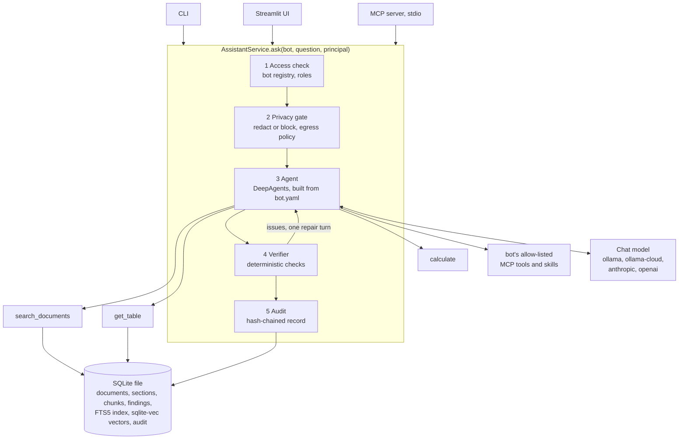
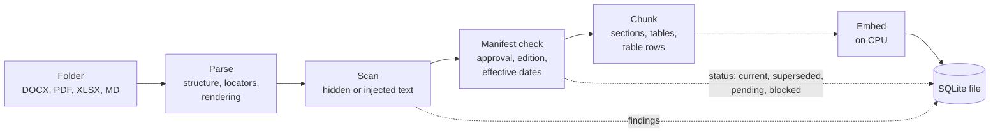
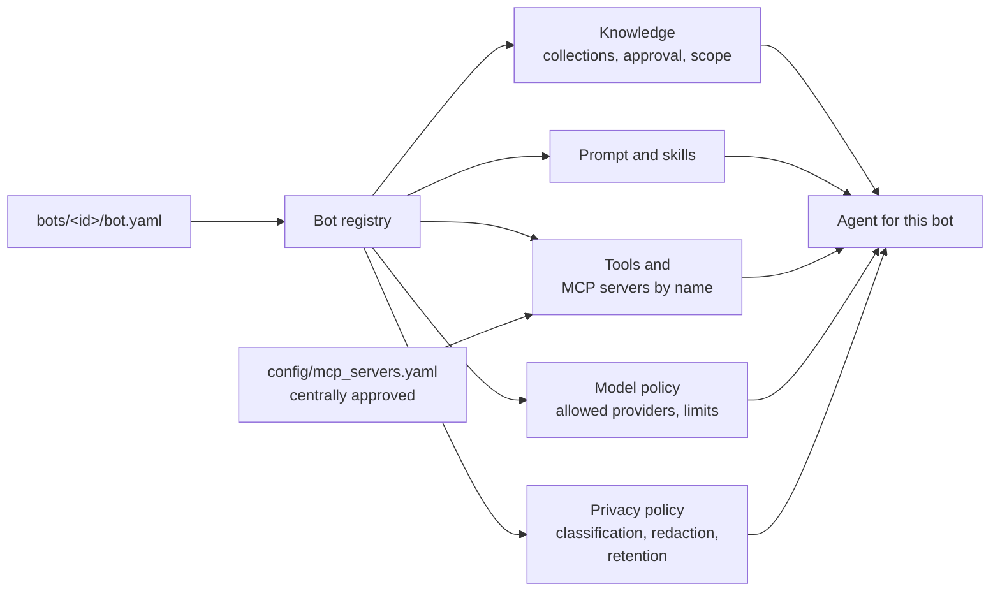

# Kestrel Assistant: design

Status: proposed, awaiting sign-off. Companion: [IMPLEMENTATION_PLAN.md](IMPLEMENTATION_PLAN.md).

## 1. Goals

The brief asks for a prototype that ingests six documents in three formats, answers only from them, cites document and section, declines when the documents are silent, runs locally, and comes with an honest evaluation and a production story.

This design meets that with one extra idea: **the assistant is a small governed platform, and Kestrel product Q&A is its first bot.** A second bot (internal policies, an IT help desk) is a new folder of configuration and documents, not new code.

Design goals, in priority order:

1. **Runs from three commands** on a laptop: no Docker, no services, one `.env`.
2. **Answers a call-centre agent can read out**, each claim backed by a quote that the application has checked against the source.
3. **The model is not trusted.** Documents are not trusted either. Both are checked by deterministic code.
4. **Privacy by default** (POPIA): personal information is removed before any model, log or store sees it, and a bot's data classification limits which model providers it may use.
5. **Bots are configuration.** Knowledge, prompt, tools, MCP servers, skills, model policy and privacy policy are declared per bot.
6. **Provider-neutral.** Local Ollama, Ollama Cloud, Anthropic and OpenAI are selected by one setting.
7. **Small enough to change live.** One service entry point; every front end is a thin adapter.

Non-goals for the prototype: authentication, multi-user concurrency at scale, Postgres, a vector server, OCR. These are covered in `PRODUCTION_ARCHITECTURE.md`.

## 2. Shape of the system

**Answering a question**



**Ingesting documents**



**How a bot is assembled**



### Module layout

```
src/kestrel/
  contracts.py        shared dataclasses and Protocols (the seams listed in section 9)
  config.py           settings from .env
  service.py          AssistantService: the only entry point used by front ends
  bots/               bot.yaml schema, loader, registry
  ingest/             parsers/, scan/, manifest, chunker, pipeline
  store/              SQLite schema, document repository, audit log, vector index
  retrieval/          embeddings, hybrid search, edition and date scope
  llm/                provider:model resolution, pricing, egress policy
  privacy/            redaction rules and policy
  agent/              agent builder, tools, calculator, MCP tool loader, answer schema
  verify/             deterministic verifier
  interfaces/         cli.py, mcp_server.py
app/streamlit_app.py
bots/<bot-id>/        bot.yaml, prompt.md, manifest.yaml, skills/, eval/
data/source/<collection>/
eval/                 evaluation runner, grading, reports
tests/
```

Rule: `interfaces/` and `app/` import only `service.py` and `contracts.py`. Nothing under `src/kestrel/` mentions insurance, Kestrel products or any document by name; a test enforces this.

## 3. Bots as configuration

```yaml
# bots/kestrel-products/bot.yaml
id: kestrel-products
name: Kestrel Product Assistant
description: Answers questions about group life, disability and funeral cover from approved guides.
audience: [call-centre-agent, broker]          # roles allowed to use this bot

knowledge:
  collections: [kestrel-products]              # the only documents this bot can search
  approval: required                           # a document must be listed in manifest.yaml
  default_scope: current                       # superseded editions only on explicit request

prompt: prompt.md                              # persona and domain guidance
tools: [search_documents, get_table, calculate]
mcp_servers: []                                # names from config/mcp_servers.yaml
skills: [skills/]                              # optional skill folders (SKILL.md)

model:
  default: ${KESTREL_MODEL}
  allowed_providers: [ollama, ollama-cloud, anthropic, openai]
  max_model_calls: 12
  max_searches: 6

privacy:
  classification: internal                     # confidential => on-device providers only
  on_personal_information: redact              # or: block
  audit_question_text: redacted                # or: none
  retention_days: 30

verification:
  on_failure: withhold                         # or: warn
evaluation:
  gold: eval/gold.yaml
```

What this buys:

- **Isolation.** A collection id is stamped on every document, chunk and vector. Search always filters by the bot's collections in SQL, before ranking. A bot cannot retrieve another bot's documents, and a test proves it.
- **Least privilege.** A bot gets only the tools, MCP servers and skills it names. MCP servers are defined once in `config/mcp_servers.yaml` (command or URL, allowed tool names, whether it runs on-device or externally, and a reviewer's statement that the listed tools only read). A server is approved centrally and bots opt in by name. An allow-list limits which tools can be called; it cannot make a tool harmless, which is why approval is a human step. Output from an MCP tool is treated as untrusted data, exactly like a document, and arguments sent to one pass the privacy gate.
- **Skills.** Procedural know-how (how to read a banded table, how to handle a two-edition conflict) lives in `SKILL.md` files loaded through DeepAgents' skills support with a read-only backend rooted at the bot's folder. The agent has no write, shell or sub-agent tools, and tests assert both the tool inventory and that paths outside the skills folder cannot be read.
- **Per-bot policy.** A help-desk bot over HR policies can be `confidential` and therefore locked to local models, while the product bot uses a hosted model.

The submission ships two bots: `kestrel-products` (the assessed one) and `staff-policies`, a small demonstration bot over three clearly labelled synthetic documents with a toy MCP server attached. It exists to prove isolation, per-bot policy and "add a bot without touching code". The 15-question evaluation uses only `kestrel-products` and only the supplied documents.

## 4. Ingestion

- **Parsers keep structure and rendering.** DOCX: headings, numbered sections, tables. PDF: page, headings, tables extracted cell by cell. XLSX: sheet, table regions, header row, cell addresses. Markdown: headings. Every text span keeps what is needed to judge visibility (colour, size, hidden flags, position).
- **Scanner.** Text a reader could not see (too little contrast, 1-pt, hidden runs, off-page) is removed from searchable content and recorded as a finding. Contrast is judged against the resolved background, including table-cell shading, so white header text on a dark cell is kept while white text on a white page is not. Instruction-like wording is flagged. The rules are generic; none name a document.
- **Citations.** Each section stores a human locator: `file > section 4.2 > heading`, `file > page 3 > table`, `file > sheet > A5:D9`.
- **Tables.** A table is stored whole as structured rows and also chunked row by row with its header, so a search hit can lead to the full table.
- **Lifecycle in data, not in the prompt.** `manifest.yaml` binds each file's SHA-256 to a family, edition, effective date, what it supersedes and an approval. Ingest marks each document `current`, `superseded`, `pending` or `blocked`. Only `current` documents are searched by default. A changed file no longer matches its approved hash and drops to `pending`.
- **Idempotent.** Re-running ingest changes nothing unless files or the manifest changed.

## 5. Retrieval

Hybrid search inside one SQLite file: FTS5 (BM25) for exact terms such as "Option B" or amounts, and `sqlite-vec` cosine search over `bge-small-en-v1.5` embeddings computed on CPU. Results are fused by reciprocal rank. Collection, status and edition filters are applied before both rankers.

Why this choice: zero extra services, all three front ends can read it at once, documents never leave the machine for indexing, and exact-term recall matters as much as meaning in rule documents. The vector index sits behind a `VectorIndex` protocol, so a managed search service replaces it without touching callers.

Superseded editions are invisible by default. A question that names one edition or one date ("under the 2025 guide", "as of 2025-06-01") *switches* the scope to the edition in force then; it never mixes two editions in one result set. A question that names two editions, or a year that could be an event date or an edition, gets a request to clarify. Blocked documents are never searchable, whatever the scope.

## 6. Answering

A DeepAgents agent, restricted to read-only tools, returns a structured answer:

```
status        answered | partial | not_found | refused
answer        short, plain language, suitable to read to a caller
citations     [{label: "c3" or "c7.r4", quote: "<verbatim text>", supports: "<the claim it backs>"}]
calculations  [{expression, result, rule: "<label of the excerpt stating the formula>"}]
caveats       conflicts, assumptions, limits
reason        required for not_found and refused
```

Tools: `search_documents` (labelled excerpts `c1, c2, ...`, with a search budget and duplicate guard), `get_table` (every row of the table an excerpt belongs to, each row labelled `c7.r1, c7.r2, ...` with its header, for band lookups) and `calculate` (a safe decimal arithmetic evaluator with defined rounding; the model never does sums itself).

The prompt requires the answer to carry the conditions attached to a rule (for example "the lower of", "aims to", "working days", "after receipt of all documents") and to quote them.

**Requirements by status**

| Status | Meaning | Must have |
|---|---|---|
| `answered`, `partial` | the documents support the answer | at least one citation; every check below passes |
| `not_found` | the documents do not establish an answer | a reason worded as "the documents do not say", never as a fact about the business; citations optional |
| `refused` | outside the bot's purpose or privacy policy | a reason and who to ask |

Two further outcomes are set by the application, not the model: `withheld` (evidence checks failed after repair) and `error`. All five are reported separately in the audit trail and in evaluation, so a retrieval miss, a correct decline and a withheld answer are never counted as the same thing.

**Evidence checks** run after the model and are plain code:

1. every cited label was actually retrieved in this request;
2. every quote is found verbatim in the excerpt, or the single table row, it cites (after whitespace and number-format normalisation);
3. a citation into a table names a row, not the whole table, so the quote must come from the row relied on;
4. every number in the answer and caveats appears in a cited quote's excerpt, the question, or a recomputed calculation (digits, grouped digits, "R5 million" and number words up to twelve are normalised);
5. every reported calculation is recomputed, each operand is traced to a cited excerpt or the question, and the calculation names the excerpt that states the rule;
6. a decline does not follow hidden arithmetic and carries a reason;
7. no citation points at a superseded or blocked document unless the question asked for that edition.

On failure the agent gets one repair turn with the specific issues. If it still fails, the bot's policy decides: `withhold` (the user sees "could not confirm against the sources", with the retrieved sections to read) or `warn`. The outcome is always shown and always audited.

**What the checks do and do not prove.** They prove the evidence exists, is quoted exactly, comes from an approved current source, and that the arithmetic is right. They do not prove the sentence is a faithful reading of the quote: an answer can cite the right passage and still drop a condition or pick the right table but argue from the wrong rule. The user interface therefore says "evidence checks passed", not "verified", and always shows the quotes beside the answer. Faithfulness is measured in evaluation (section 10) and, in production, by sampled human review. Fully deterministic validation of free prose is out of scope.

This gives readable answers with checkable evidence: the model writes the sentence, the application proves the quote and the numbers, and a person can confirm the reading at a glance.

## 7. Privacy and security

**Privacy gate, before anything else.** A question is normalised and screened for South African ID numbers (date and checksum validated), phone numbers, emails, bank and policy identifiers, labelled names and dates of birth, plus operator-supplied patterns. Per bot policy the text is redacted or the request is blocked. The model, MCP tools, the audit log and the UI history receive only the screened text. If screening fails, the request fails closed.

Pattern screening is best effort. It will miss an unlabelled name or a free-text description of someone's health, so it reduces exposure rather than guaranteeing none. That residual risk is why the prototype also keeps question text out of the audit log unless a bot opts in and sets a retention period, and why production adds entity recognition and an in-region redactor. The gate screens what users type; source documents are assumed to be approved business content and are checked for hidden text, not for personal information.

**Egress policy.** Every destination that could receive text is tagged `on-device` or `external`: model providers, MCP servers, and the Ollama endpoint (on-device only when its host is loopback). A bot classed `confidential` cannot start with any external destination; the check runs at start-up and again per request. Framework tracing to third-party services is switched off in code.

Keeping data on the device is one control, not POPIA compliance. Operator agreements, cross-border transfer safeguards, retention and deletion duties, and breach handling are organisational, and are set out condition by condition in `PRODUCTION_ARCHITECTURE.md`.

**Purpose limits.** The assistant gives general product information. It refuses member-specific decisions (will this claim be paid, is this person covered) and says who to ask.

**Untrusted content.** Documents and MCP tool output are data. Hidden text is stripped at ingest, excerpts are wrapped with a data-only notice, the agent has no tools with side effects, and the verifier limits what an injected instruction could achieve to text that must still be quoted from an approved source.

**Audit.** One append-only, hash-chained table: bot, channel, principal, screened question or its digest, retrieved excerpts, citations, calculations, outcome, model, tokens, cost, latency. Retention is per bot; pruning writes a checkpoint row that carries the chain forward. `kestrel audit verify` detects an edited or deleted row. This is limited tamper evidence: someone with write access to the file could rebuild the whole chain, so production anchors the chain head in a separate write-once store. Blocking a document lists every past answer that cited it.

**Access.** Every service call carries a `Principal` (user, roles, channel), and the role check applies to every method, not only `ask`: search, section lookup, document listing and audit reads are all scoped to bots the principal may use. The prototype takes the principal from local settings; production maps it from single sign-on. The seam is real, the identity provider is not.

**Secrets.** Keys only in `.env`, never logged, `.env` ignored by git, `kestrel doctor` reports which keys are present without printing them.

## 8. Models and configuration

One setting selects the model: `KESTREL_MODEL=<provider>:<model>`.

| Provider prefix | Runs where | Needs |
|---|---|---|
| `ollama` | this machine | Ollama running, model pulled |
| `ollama-cloud` | Ollama Cloud | `OLLAMA_API_KEY` |
| `anthropic` | Anthropic API | `ANTHROPIC_API_KEY` |
| `openai` | OpenAI API | `OPENAI_API_KEY` |

Resolution goes through LangChain chat models, so adding Azure OpenAI, Bedrock or Vertex is a mapping entry, not a new client.

Tool calling and structured output vary by model, not just by provider. The repository therefore names the models it was tested with, uses tool-call based structured output (the strategy that works alongside other tools on all four providers), retries a malformed answer a bounded number of times, and enforces one total budget per question covering model calls, searches, repairs and wall-clock time. An untested model works if it supports tool calling; `kestrel doctor` says whether the configured model is on the tested list.

The service API is synchronous. It runs the agent on an event loop it owns, so Streamlit reruns and the MCP server's own loop never share loop-bound clients. Token usage is read from each response and priced from `config/pricing.yaml`, giving a measured cost per query. `kestrel doctor` checks the environment end to end and prints the exact fix for anything missing.

## 9. Seams for scale

Each is a `Protocol` in `contracts.py` with one local implementation:

| Seam | Prototype | Production direction |
|---|---|---|
| `DocumentRepository`, `AuditLog` | SQLite | managed relational database |
| `VectorIndex` | sqlite-vec | managed hybrid search service |
| `Embedder` | fastembed on CPU | larger multilingual model, in region |
| chat model | LangChain provider | LLM gateway with routing, quotas, fallback |
| `PrivacyScreen` | rules | rules plus NER plus in-region redactor |
| `Principal` source | local settings | single sign-on and group mapping |
| bot registry | folders in git | reviewed config repo or admin service |
| MCP server | stdio | streamable HTTP behind OAuth |

`PRODUCTION_ARCHITECTURE.md` maps each seam to Azure, AWS and Google Cloud services and covers residency, POPIA conditions, monitoring, cost and rollout.

## 10. Evaluation

- `eval/run_eval.py` runs the 15 questions through `AssistantService` for one or more models and runs, and writes a CSV, a JSONL trace, and a completed copy of `KA_Test_Questions.xlsx`.
- Automatic grading against a gold file is kept separate from the human assessment column; both are reported.
- The gold file holds, per question: the expected status, the facts that must appear, the **conditions that must not be dropped** (for example "lower of", "working days", "accidental death is covered immediately"), statements that must not appear, and the section that should be cited. This is where answer faithfulness is measured.
- Outcomes are counted separately: correct, partially correct, incorrect, correctly declined, incorrectly declined, withheld by the evidence checks, and retrieval miss (the gold section was never retrieved).
- Extra checks: the hidden-instruction document, edition conflicts, bot isolation, and personal-information redaction.
- Results report cost and latency per query per model, and every failure with its cause.

## 11. Decisions and trade-offs

| Decision | Why | Cost accepted |
|---|---|---|
| SQLite + FTS5 + sqlite-vec in one file | runs anywhere, one thing to back up, concurrent readers | not a distributed index; replaced behind the seam |
| Agent with tools, not single-shot RAG | band lookups and arithmetic need tools | 3 to 5 model calls per answer |
| Quote-backed citations and a code verifier | hallucination becomes detectable, not just unlikely | some good answers are withheld when a quote is paraphrased |
| Edition status in a manifest | "which guide is current" is a governance fact, not a model guess | someone must maintain the manifest |
| Bots as folders of YAML | new use cases without code; reviewable in git | a schema to keep stable |
| Local CPU embeddings | documents stay on the machine; free | smaller model than production would use |
| DeepAgents on LangChain | one agent runtime across four providers, skills and MCP support | a framework dependency to pin |
