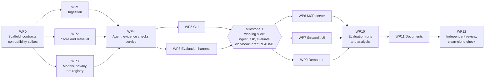

# Kestrel Assistant: implementation plan

Status: proposed, awaiting sign-off. Design: [DESIGN.md](DESIGN.md).

## How the work is organised

- The design and this plan are written by the lead model and approved by the candidate.
- Implementation is done by sub-agents, one work package (WP) each, in isolated worktrees. No two writers share a worktree. Each WP owns a fixed set of paths and may not edit outside them.
- Shared files (`pyproject.toml`, `uv.lock`, `contracts.py`, `.env.example`) are changed only by the integrator. A WP that needs a new dependency or contract change requests it in its hand-off note.
- Every WP ends with: its tests passing, a short hand-off note (what was built, what was not, open questions), and no edits outside its paths.
- The lead reviews and integrates each wave before the next starts.
- **The brief's required deliverables come first.** Milestone 1 is a complete, submittable slice: ingest, ask from the CLI, the 15-question evaluation on one model, the filled workbook and a draft README. Everything after it (MCP server, Streamlit, demo bot, wider model matrix) is an addition to something that already works, and each can be cut without breaking the rest.

## Conventions

- Diagrams in documents are written in Mermaid.

- Python 3.12, `uv` with a committed lockfile, plus an exported `requirements.txt`.
- Files under 500 lines. Typed public functions. No document-specific or insurance-specific logic under `src/`.
- Tests are offline by default: a scripted fake chat model and a deterministic fake embedder. Tests that call a real provider are marked `live` and skipped unless asked for.
- Errors a user can cause produce a clear message and a non-zero exit, never a traceback.
- Library APIs (DeepAgents, LangChain, MCP SDK, sqlite-vec) are checked against the installed version before use, not assumed.
- Commit style: `<type>(<scope>): <description>`.

## Wave 0: foundation (one agent, then freeze)

**WP0 Scaffold and contracts**
Paths: `pyproject.toml`, `uv.lock`, `requirements.txt`, `.env.example`, `.gitignore`, `src/kestrel/{__init__,contracts,config}.py`, `src/kestrel/store/schema.py`, `tests/conftest.py`, `tests/fakes.py`, `tests/spikes/**`, `data/source/kestrel-products/`.

- Project skeleton, pinned dependencies (DeepAgents 0.7.41 or later), `kestrel` console script.
- `contracts.py`: `Principal`, `BotConfig`, `ParsedDocument`, `Section`, `Chunk`, `Finding`, `SearchHit`, `SearchScope`, `Answer`, `Citation`, `Verification`, `AskResult`, `ManifestEntry`, and the Protocols `DocumentRepository`, `VectorIndex`, `Embedder`, `PrivacyScreen`, `AuditLog`.
- Frozen with concrete signatures before Wave 1: every `AssistantService` method the front ends need (`ask`, `search`, `get_section`, `list_bots`, `list_documents`, `block_document`, `affected_answers`, `audit_tail`, `audit_verify`, `doctor`), all synchronous and all taking a `Principal`; excerpt, row and document identifiers; the error type and its user-safe categories; transaction boundaries for ingest and audit writes; the JSONL trace record and the workbook column mapping used by evaluation.
- SQLite schema with a version table: collections, documents, sections, chunks, FTS5 table, vector table, findings, audit.
- Fakes: scripted chat model, deterministic embedder, temp-database fixture.
- The six source documents copied in unchanged.
- Compatibility spikes, kept as tests, on the exact uv-managed Python 3.12 build on Windows:
  - sqlite-vec: load the bundled extension on a connection, disable loading again, insert vectors, run a filtered nearest-neighbour query; FTS5 create and query. Importing the package is not enough.
  - DeepAgents: build an agent with a skills folder and assert the final tool inventory contains no write, edit, shell or sub-agent tools, that a skill file can be read, and that a path outside the skills folder cannot.
  - Structured output: the answer schema round-trips through the agent with the scripted model.
  - MCP: a stdio server launched as a real child process (absolute interpreter path, argument array, stderr captured) answers one call and shuts down cleanly.

Done when: `uv sync` and `uv run pytest` pass on a clean clone; all spikes pass or the design is changed before Wave 1; contracts reviewed and frozen.

## Wave 1: three packages in parallel

**WP1 Ingestion**
Paths: `src/kestrel/ingest/**`, `bots/kestrel-products/manifest.yaml`, `tests/ingest/**`.
Parsers for DOCX, PDF, XLSX and Markdown that keep structure, locators and rendering attributes; visibility and injection scanners; manifest loading and lifecycle status; chunker (prose by section, tables whole and by row); idempotent pipeline writing through `DocumentRepository`.
Done when: all six documents ingest; the hidden instruction in the claims FAQ is excluded and recorded while the visible text beside it is kept; light text on a shaded table cell (the funeral benefit table headers) is kept; the two life-guide editions get `superseded` and `current`; every section has a readable locator; a second ingest is a no-op; a modified file becomes `pending`.

**WP2 Store and retrieval**
Paths: `src/kestrel/store/**` (except `schema.py`), `src/kestrel/retrieval/**`, `tests/store/**`, `tests/retrieval/**`.
SQLite repository, sqlite-vec index, fastembed embedder, hybrid search with reciprocal rank fusion, pre-ranking filters for collection, status and edition, question scope parsing for explicit editions and dates, full-table fetch, hash-chained audit log with verify, prune and "which answers cited this document".
Done when: collection isolation is proven by test; superseded documents are invisible by default; an explicit edition or date switches to exactly one edition and never mixes two; two editions in one question returns a clarification request; blocked documents are never returned; audit chain verification detects an edited row; search works when the vector extension is unavailable (keyword-only, with a warning).

**WP3 Models, privacy and bot registry**
Paths: `src/kestrel/llm/**`, `src/kestrel/privacy/**`, `src/kestrel/bots/**`, `bots/kestrel-products/{bot.yaml,prompt.md}`, `config/**`, `tests/llm/**`, `tests/privacy/**`, `tests/bots/**`.
`provider:model` resolution for `ollama`, `ollama-cloud`, `anthropic`, `openai` with clear errors for missing keys or unreachable Ollama; a tested-models list per provider; tool-call structured output; usage and cost accounting; locality tags for providers, MCP servers and the Ollama endpoint, and the egress policy; third-party tracing disabled; redaction rules with a validated SA ID check; bot schema, loader with `${ENV}` expansion and validation, registry.
Done when: each provider resolves under a fake key without network; a `confidential` bot refuses an external provider; redaction tests cover each identifier type and near-misses (a 13-digit number that is not an ID, "R50 000"); an invalid `bot.yaml` fails with the field name.

## Wave 2: the answering core

**WP4 Agent, verifier and service**
Paths: `src/kestrel/agent/**`, `src/kestrel/verify/**`, `src/kestrel/service.py`, `tests/agent/**`, `tests/verify/**`, `tests/test_service.py`.
Safe calculator; `search_documents`, `get_table`, `calculate` bound to a per-request context; agent builder from `BotConfig` (prompt, tools, limits, retries on transient errors only, structured output, built-in file-write, shell and sub-agent tools removed); skills loading with a read-only backend; MCP tool loader with allow-list and untrusted-output wrapping; the status contract and the seven evidence checks from the design; one repair turn; one total budget per question (model calls, searches, repairs, wall-clock); the full `AssistantService` from the frozen contract, wiring access check, privacy gate, agent, evidence checks and audit on an event loop the service owns.
Done when: with the scripted model, unit tests cover each evidence check passing and failing, table-row citations, a correct decline with no citation, the repair path, withhold versus warn, redaction before the model call, role refusal, and audit rows for success, decline and error; a `live` smoke test answers "What waiting period applies to disability income Option B?" with a quote that passes the evidence checks.

## Wave 3: the working slice (parallel)

**WP5 CLI**
Paths: `src/kestrel/interfaces/cli.py`, `tests/interfaces/test_cli.py`.
`ingest`, `ask` (with `--bot`, `--model`, `--trace`, `--json`), `search`, `bots`, `docs` (list, show, block, unblock, affected), `audit` (show, verify, prune), `doctor`, `mcp`.

**WP8 Evaluation harness**
Paths: `eval/**`, `bots/kestrel-products/eval/**`, `tests/eval/**`.
Runner over the 15 questions by model and run count; gold file (expected status, required facts, conditions that must not be dropped, forbidden statements, expected section) and automatic grading with unit tests for the grader; outcomes counted separately (correct, partial, incorrect, correctly declined, incorrectly declined, withheld, retrieval miss); CSV, JSONL and filled workbook output that keeps the workbook's formulas and dropdown validation and never overwrites a human assessment already entered; offline re-grade from saved JSONL; cost and latency summary.

**Milestone 1.** Integrate WP5 and WP8, run the 15 questions once on the primary model, review the answers by hand, fill the workbook and write a draft README. From here the repository is submittable at every commit.

## Wave 4: additions (parallel, each can be cut)

**WP6 MCP server**
Paths: `src/kestrel/interfaces/mcp_server.py`, `tests/interfaces/test_mcp.py`, `examples/mcp_servers/**`.
Stdio server exposing `list_bots`, `ask`, `search`, `get_section`, with typed results, input limits, bounded concurrency and safe error messages. A toy stdio server for the demo bot. A test that starts the server as a real child process on Windows, makes a call and shuts it down, plus a README snippet for connecting a desktop MCP client.

**WP7 Streamlit UI**
Paths: `app/**`.
Bot picker; chat with answer, verdict badge, citations with quotes, caveats and calculations; documents and findings; audit trail; evaluation results. Reads only through the synchronous `AssistantService`; no event-loop-bound object is cached across reruns.

**WP9 Demo bot**
Paths: `bots/staff-policies/**`, `data/source/staff-policies/**`, `bots/kestrel-products/skills/**`, `tests/test_isolation.py`.
Three short synthetic policy documents marked as fictitious, a `confidential` bot config locked to on-device models with the toy MCP server attached, skills for the product bot, and tests that each bot sees only its own collection.

## Wave 5: measure, document, harden

**WP10 Evaluation runs and analysis** (lead with one agent)
Run the 15 questions three times on the primary model, and once on one model from each other provider. Keep the results of the first run before any fix. Review every answer by hand; record the human assessment separately from the automatic grade. Say plainly in the write-up that the 15 questions were also the development set, and report a small set of reworded questions, written before the first run, as the nearest thing to an independent check. Fix genuine defects through the owning module, never with question-specific rules, and re-run. Record tokens, cost and latency. Write up every failure and what changed.

**WP11 Documents**
Paths: `README.md`, `docs/**`.
`README.md` (1 to 2 pages, covering each item the brief lists), `docs/BUSINESS_NOTE.md` (half a page), `docs/AI_DISCLOSURE.md`, `docs/ARCHITECTURE.md` (from the design), `docs/PRODUCTION_ARCHITECTURE.md` (Azure, AWS and Google Cloud mappings, POPIA condition by condition, security, monitoring, cost, scale, rollout), `docs/ADDING_A_BOT.md`, `docs/EVALUATION.md`, `docs/DEMO.md`. Every number in a document is taken from a results file.

**WP12 Independent review and clean-clone check**
A second model reviews the code for security and correctness. A fresh clone is set up from the README alone on this machine, for each provider. Findings are fixed or listed under known limitations.

## Acceptance for the whole submission

| Brief criterion | Evidence |
|---|---|
| Works end to end | clean clone: `uv sync`, `kestrel ingest`, `kestrel ask` succeed; `kestrel doctor` is green |
| Retrieval and answer quality | 15-question results per model; every answered question has a quote-backed citation that passes the evidence checks and keeps the conditions in the gold file; both unanswerable questions are declined with a reason |
| Evaluation | one command regenerates the CSV and workbook; failures listed with causes |
| Production thinking | production architecture document; working privacy gate, egress policy, audit chain, document block and impact |
| Code quality | tests pass offline; files under 500 lines; no document-specific rules in `src/` |
| Communication | README within 2 pages; business note within half a page; AI disclosure |

## Risks

| Risk | Mitigation |
|---|---|
| Scope against a four-hour brief | thin adapters over one service; the README states the time spent and what was cut |
| Framework API drift | pinned lockfile; APIs verified against installed versions in WP0 and WP4 |
| sqlite-vec fails to load on a reviewer's Python | keyword-only fallback with a warning; `doctor` explains |
| Small local models fail structured output | repair turn; evaluation reports per-model results honestly; README recommends tested models |
| Evidence checks reject good answers | withheld answers are counted separately in evaluation and tuned by general rules with tests |
| Evidence checks pass an answer that drops a condition | gold file lists required conditions; the UI shows quotes beside every answer and says "evidence checks passed", not "verified" |
| First-run embedding download | stated in the README; `doctor` pre-checks it |

## Order and checkpoints

1. Sign-off on design and plan.
2. WP0 with spikes, then contract freeze.
3. Wave 1 in parallel, integrate, run all six documents through ingest and search.
4. WP4, integrate, first live answers.
5. WP5 and WP8 in parallel, integrate, Milestone 1.
6. Wave 4 in parallel, integrate.
7. Wave 5.
8. Candidate review and submission.

Each integration is a commit, so the commit history is the record of time spent.
