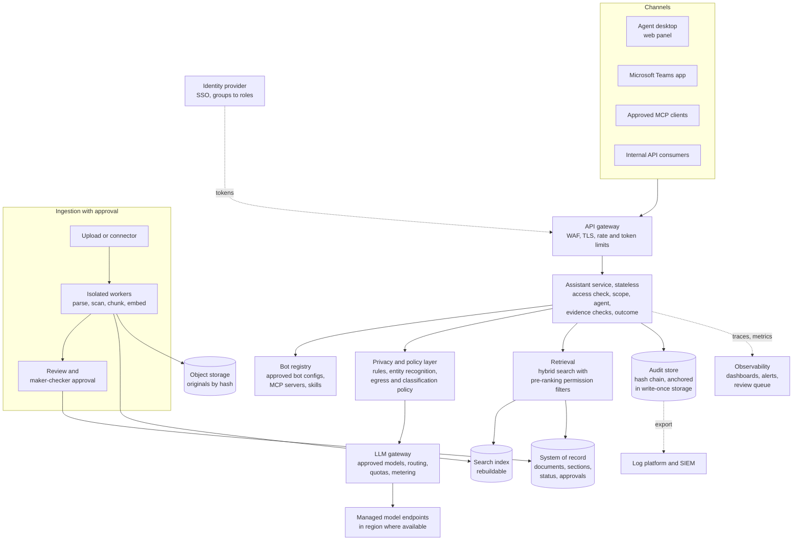
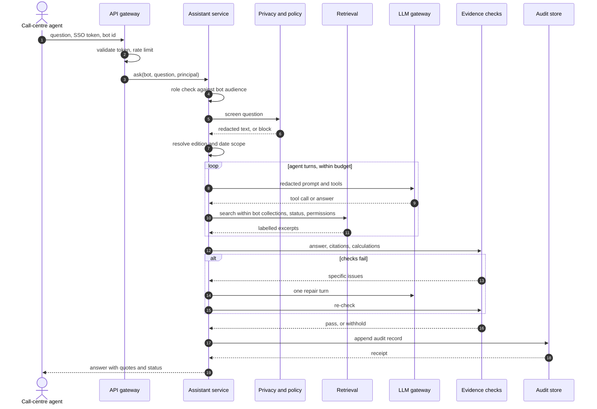
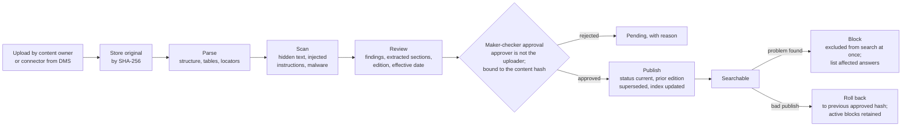

# Kestrel Assistant: production architecture

Status: proposal for discussion. Companion to [DESIGN.md](DESIGN.md), which describes what is built.

This document explains how the assistant would run as a governed service in a large financial-services organisation: what changes, which cloud services fit each part, how the multi-bot platform is governed, and how security, POPIA, monitoring, cost and rollout are handled. It is written to be honest about the gap. The prototype proves the controls and the seams; it does not prove scale, identity, or organisational readiness.

**How to read the vendor statements.** Cloud service names, model families and regional availability in sections 3 and 4 are general knowledge at the time of writing. Providers rename services and change what runs in which region often. Every such statement must be confirmed with the provider, for the chosen region, at design time.

## 1. What changes from prototype to production

Each row is a seam in `src/kestrel/contracts/`. Callers depend on the Protocol, not the implementation, so each replacement is local.

| Seam | Prototype (built) | Production |
|---|---|---|
| `DocumentRepository` (system of record) | One SQLite file: documents, sections, chunks, findings, manifest status | Managed relational database (PostgreSQL), private network only, point-in-time restore, encrypted with organisation-held keys |
| Original files | A folder per collection, approval by SHA-256 in `manifest.yaml` | Object storage with versioning and retention lock; files addressed by content hash |
| `VectorIndex` and `Retriever` (hybrid search) | SQLite FTS5 (BM25) plus `sqlite-vec`, fused by reciprocal rank, filters applied before ranking | pgvector in the same PostgreSQL, or a managed hybrid search service; same pre-ranking filters by collection, status, edition and document permission. Treated as rebuildable from the system of record |
| `Embedder` | `bge-small-en-v1.5` on CPU via fastembed | Larger multilingual embedding model hosted in region; model name stored beside every vector so a change forces a re-index |
| Chat model access | LangChain provider selected by `KESTREL_MODEL` (Ollama, Ollama Cloud, Anthropic, OpenAI) | LLM gateway: approved model catalogue, per-bot routing, quotas, fallback, token metering, no-retention terms, in-region endpoints where available |
| `PrivacyScreen` | Deterministic rules: validated SA ID numbers, phones, emails, labelled account, policy and reference numbers, labelled names, dates of birth, operator patterns. Fails closed | Same rules, plus entity recognition for names, addresses and health terms, an in-region redaction service, and DLP scanning of stores and logs. Measured against a labelled test set in CI |
| Egress policy | Each destination tagged `on-device` or `external`; `confidential` bots may use on-device destinations only; tracing to third parties switched off in code | Destinations tagged by approved data classification and region; network egress allow-list enforced by the platform, not only by code |
| Identity (`Principal`) | User, roles and channel from local settings | Single sign-on (OIDC), group-to-role mapping, service identities for channels, per-call authorisation on every service method |
| Bot registry | Folders of YAML in git (`bots/<id>/bot.yaml`), validated at load | Reviewed configuration repository with maker-checker approval and CI evaluation gates, published to a registry service |
| MCP transport | stdio, local client | Streamable HTTP behind the API gateway, OAuth with scoped, short-lived tokens, per-principal rate limits |
| `AuditLog` | Append-only, hash-chained SQLite table; `audit verify` detects an edited or deleted row; per-bot pruning with checkpoint rows | Same record shape in the relational database, chain head anchored periodically in write-once storage, exports to the organisation's log platform and SIEM |
| Ingestion | CLI over a folder; parse, hidden-text scan, manifest check, chunk, embed; idempotent | Queue-driven workers, isolated with no outbound network; maker-checker approval bound to the content hash; staged publish with rollback |
| Observability | Tokens, cost and latency in each audit row; evaluation reports | OpenTelemetry traces and metrics, dashboards, alerts, human review queue |

What does not change: the answer contract (`answered`, `partial`, `not_found`, `refused`, plus application-set `withheld` and `error`), the seven deterministic evidence checks, edition scoping, collection isolation, and the rule that nothing under `src/` is specific to a document or a business line.

## 2. Target architecture



The assistant service holds no session state, so it scales horizontally. Conversation history, if a channel needs it, is held by the channel or in a short-lived store under the bot's retention policy.

**One question, end to end**



In production the audit append completes before the answer is returned. If the audit store is unavailable, the service returns an operational error rather than an unrecorded answer.

**Document intake**



An approval names the exact bytes. A file that changes after approval no longer matches and drops back to `pending`, which is how the prototype's manifest already behaves. Production adds the review screen, the separation of uploader and approver, and an audit entry for each step.

## 3. Cloud service mapping

General knowledge, to be verified at design time for the chosen region.

| Capability | Azure | AWS | Google Cloud |
|---|---|---|---|
| Container hosting | Azure Container Apps; AKS | ECS on Fargate; EKS | Cloud Run; GKE |
| Managed relational database | Azure Database for PostgreSQL (Flexible Server, pgvector extension); Azure SQL Database | Amazon Aurora PostgreSQL or RDS for PostgreSQL (pgvector) | Cloud SQL for PostgreSQL or AlloyDB (pgvector) |
| Managed hybrid and vector search | Azure AI Search (keyword, vector, hybrid, semantic ranker) | Amazon OpenSearch Service (hybrid queries); Bedrock Knowledge Bases | Vertex AI Search; Vertex AI Vector Search |
| Object storage with retention lock | Blob Storage with immutability policies | S3 with Object Lock | Cloud Storage with Bucket Lock |
| Model access | Azure OpenAI and the Microsoft Foundry model catalogue: OpenAI GPT models, plus Meta Llama, Mistral, DeepSeek and others; Anthropic Claude has been added to Foundry | Amazon Bedrock: Anthropic Claude, Amazon Nova, Meta Llama, Mistral, Cohere, and others | Vertex AI: Google Gemini, plus Anthropic Claude, Llama, Mistral and open models through Model Garden |
| Embedding models | Azure OpenAI embeddings; catalogue models | Amazon Titan and Cohere embeddings on Bedrock | Vertex AI text embeddings (Gemini embedding models) |
| API gateway | Azure API Management (includes AI gateway policies: token limits, metering) | Amazon API Gateway | Apigee; API Gateway |
| Identity | Microsoft Entra ID; managed identities | IAM Identity Center federated to the corporate IdP; IAM roles | Cloud Identity or Workforce Identity Federation; service accounts |
| Secrets and keys | Key Vault; Managed HSM | Secrets Manager; KMS; CloudHSM | Secret Manager; Cloud KMS; Cloud HSM |
| Queues and events | Service Bus; Event Grid | SQS; EventBridge | Pub/Sub; Eventarc |
| Observability | Azure Monitor, Application Insights, Log Analytics | CloudWatch; X-Ray | Cloud Monitoring, Cloud Logging, Cloud Trace |
| PII detection and DLP | Azure AI Language PII detection; Microsoft Purview | Amazon Comprehend PII detection; Amazon Macie; Bedrock Guardrails sensitive-information filters | Sensitive Data Protection (Cloud DLP) |
| Prompt-injection screening | Azure AI Content Safety Prompt Shields | Bedrock Guardrails prompt-attack filter | Model Armor |
| Document parsing and OCR | Azure AI Document Intelligence | Amazon Textract | Document AI |
| Teams channel | Azure Bot Service | Azure Bot Service (Teams is Microsoft-hosted) | Azure Bot Service |

All three expose OpenTelemetry-compatible collection, so the service emits one telemetry format whatever the host. Managed PII services are tuned mostly for US and European formats; South African ID numbers, phone formats and internal policy and member numbers need the custom rules the prototype already has.

**PostgreSQL with pgvector or a dedicated search engine.** For one collection of a few thousand sections, the system of record and the vectors fit comfortably in one PostgreSQL database. pgvector gives approximate nearest-neighbour search, PostgreSQL full-text search gives the keyword side, and permission filters are an ordinary `WHERE` clause in the same transaction as the publish. One store means one backup, one access model and no drift between record and index. This is the right default until measured load says otherwise.

A dedicated engine earns its place when one of these is measured, not assumed: many collections and millions of chunks, strict latency at high concurrency, a need for built-in semantic reranking, or independent scaling of search from transactions. Managed choices are Azure AI Search, OpenSearch or Vertex AI Search. Qdrant, self-hosted on the container platform or as its managed cloud, suits teams that want a portable vector engine with payload filtering and no lock-in to one cloud's search product; its keyword side is weaker than a full-text engine, so hybrid search needs care. In every case the index is derived data, rebuilt from the system of record, and the pre-ranking filter rule from the prototype (`VectorIndex.search` ranks only allowed documents, never trims a global top-k) is a release test.

### South African regions and data residency

- **Regions.** Azure has two South African regions (South Africa North, Johannesburg; South Africa West, Cape Town). AWS has one (Africa, Cape Town). Google Cloud has one (Johannesburg). Confirm current regions and, more importantly, which of the services above are offered in them.
- **Data at rest.** System of record, originals, index, audit, logs and backups can normally be kept in South Africa on all three. Backups, log exports and replicas inherit the same rule.
- **Disaster recovery.** With two in-country regions, recovery can stay in South Africa. With one, the choices are zone redundancy inside the region (protects against a data-centre failure, not a regional one) or a secondary region abroad, which is a cross-border transfer and an Information Officer decision.
- **Model inference is the hard part.** Which model families can be called from an in-country endpoint differs by provider and changes over time. Newer models often reach other regions first. Some services route requests to other regions for capacity unless that is switched off. Region availability for each approved model must be confirmed at design time, not assumed from this document. If inference leaves South Africa, the prompt (already screened) crosses the border at that point and section 6 applies.
- **Fallback when no suitable in-region model exists:** keep `confidential` bots on in-region or self-hosted open models; allow `internal` bots to use an out-of-region endpoint only with a documented transfer basis, no-retention and no-training terms, and the redaction layer in front.

### Recommended default for a Microsoft-centric organisation

Azure: Container Apps (or AKS where it is the standard), Azure Database for PostgreSQL with pgvector as system of record and first search index, Azure AI Search added only when measured need appears, Azure OpenAI or Foundry models through API Management as the LLM gateway, Entra ID for staff and managed identities for services, Key Vault, Service Bus, Azure Monitor, Azure AI Language PII plus the existing rules, Document Intelligence for scanned documents, and a Teams app. This reuses identity, network, security operations and procurement the organisation already runs, and Azure's two in-country regions simplify recovery.

**Why a later move stays affordable.** Business logic sits behind Protocols. A move to AWS or Google Cloud replaces adapters (`DocumentRepository`, `VectorIndex`, `Embedder`, model mapping, `PrivacyScreen`) and infrastructure code, not the agent, the evidence checks, the bot configs or the evaluation sets. PostgreSQL is available on all three. Models are reached by `provider:model` through the gateway, and every model change is gated by the same evaluation, so swapping provider is a measured release rather than a rewrite.

## 4. Multi-bot platform at scale

In the prototype a bot is a folder: `bot.yaml`, a prompt, a manifest, optional skills and an evaluation file. Production keeps that idea and adds governance around it.

| Concern | How it works in production |
|---|---|
| Bot configs | Held in a configuration repository. A change is a pull request reviewed by the bot owner and the platform team, validated against the schema, and released only after its evaluation set passes |
| Knowledge | Each bot has its own collections. Documents carry permission groups as well as a collection id; retrieval filters by collection, status and the caller's groups before ranking, so a user never receives an excerpt they could not open themselves |
| Model policy | Per bot: allowed models from the approved catalogue, budgets per question, default and escalation model |
| Data classification | Per bot: `public`, `internal`, `confidential`. Classification decides which model endpoints and regions are permitted, whether question text is stored, and retention |
| MCP servers and skills | A central registry. Each entry has an owner, a security review, the exact tool names allowed, whether tools read or write, where it runs, and its data classification ceiling. Bots opt in by name; a bot cannot reach an unregistered server |
| Evaluation | Each bot owns a golden set. CI runs it on every change to prompt, model, index or config; release is blocked if it falls below the bot's thresholds |
| Cost | Every audit record carries bot, model, tokens and cost; dashboards and chargeback are per bot and per business unit |

**Three example future bots**

| Bot | Reused unchanged | New |
|---|---|---|
| Internal policies (HR, conduct, leave) | Service, agent, evidence checks, privacy screen, audit, ingestion, channels | HR policy collection with content owners; `confidential` classification, so in-region models only; staff audience; golden set from HR queries |
| IT help desk | All of the above, plus the table and calculator tools | Knowledge-base articles via a connector; one registered MCP server that reads ticket status (read-only, reviewed); audience of all staff; a higher volume and a cheaper default model |
| Claims procedures | All of the above, plus edition scoping and the block/affected-answers process | Procedure documents with strict maker-checker approval; refusal rules for member-specific decisions tightened; health terms expected in questions, so stronger redaction and question text not stored; release gates set by the claims QA lead |

Each new bot is configuration, documents, a golden set and approvals. Code changes are needed only for a new kind of tool, and that goes through the MCP registry review.

## 5. Security

| Threat | Prototype control | Production control | Residual risk |
|---|---|---|---|
| Prompt injection in documents | Hidden and low-contrast text removed at ingest and recorded as a finding; instruction-like wording flagged; excerpts wrapped as data; no side-effecting tools; every claim must be quoted from an approved source | Same, plus human review of findings before approval and a managed prompt-injection classifier on excerpts | Visible but misleading text in an approved document is answered from. Approval is the control |
| Prompt injection in user input | Agent has read-only tools only; evidence checks limit output to quoted approved text | Gateway-level injection screening; per-user rate limits; anomaly alerts on refusals and withheld answers | A user can still get an odd but evidence-backed answer; no data or action is gained |
| Tool or MCP abuse | Central allow-list by tool name; tool output treated as untrusted; arguments screened | MCP over authenticated HTTP, scoped short-lived tokens, read-only servers by default, security review in the registry, per-tool rate limits and audit | A reviewed tool with a hidden write path. Review and least-privilege credentials on the server side limit it |
| Data exfiltration through model providers | Privacy screen before any model; egress policy by classification; third-party tracing off | In-region endpoints where available, no-retention and no-training terms, network egress allow-list, DLP on prompts and logs | Unrecognised personal information in free text reaches the provider |
| Cross-bot leakage | Collection id on every document, chunk and vector; filter in SQL before ranking; tested | Same, plus document permission groups and per-bot service identities with database row-level security | A misconfigured collection assignment. Caught by registry review and isolation tests |
| Privilege escalation | Role check on every service method | SSO roles, separate operator role for publish, block and audit read; privileged actions audited; no shared accounts | Insider misuse of a legitimate operator role |
| Poisoned or tampered documents | Approval bound to SHA-256; changed file drops to `pending`; block and affected-answer listing | Maker-checker approval, retention-locked originals, malware scan, isolated parsers with no network and resource limits | A wrong document approved by two people |
| Audit tampering | Hash chain; `audit verify` detects edits and deletions | Chain head anchored in write-once storage; database writer cannot alter anchors; export to SIEM | An attacker with both database and anchor access |
| Denial of wallet | Per-question budget on model calls, searches, repairs and wall-clock time | Gateway token quotas per user, bot and month; budget alerts at set fractions; circuit breaker to a cheaper model or to "use the manual process" | A burst within quota still costs money until alerts fire |
| Supply chain | Pinned lockfile | Dependency and container scanning, signed images, private package mirror, SBOM, model and MCP server provenance in the registry | A compromised upstream release before it is detected |

**Platform controls.** Private networking for database, index, object storage and model endpoints, with no public endpoints. TLS everywhere. Encryption at rest with organisation-managed keys. Secrets only in the key vault, fetched with managed identities; no keys in configuration or images. Ingestion workers run without outbound network access. The service identity of each bot can read only its collections. MCP servers run under their own identities with the narrowest credentials their tools need, and their tokens are scoped to a bot and a principal, so a tool call is always attributable to a person.

## 6. POPIA

Keeping data in region or on the device is one control. It is not compliance. Compliance is a set of organisational duties that the system supports.

**What the privacy screen does today, and does not.** The prototype redacts identifiers that have a recognisable shape or label: validated South African ID numbers, phone numbers, emails, labelled account and policy numbers, labelled names, dates of birth, and patterns an operator adds. It fails closed. It is best effort: it will miss an unlabelled name ("my client Thandi"), a description of someone's illness, or an identifier written in words. Production adds entity recognition (names, addresses, health terms), an in-region redaction service, DLP scanning of stored text and logs, and a labelled test set with recall targets that runs in CI. Even then, the right assumption is that some personal information will get through, which is why question text is not stored by default and providers are bound by contract.

| Condition | What the system does | What the organisation must do |
|---|---|---|
| Accountability | Audit of every question, answer, approval and block; owners recorded per bot and per document | Information Officer accountable; named product owner and content owners; personal information impact assessment before launch |
| Processing limitation (lawfulness, minimality, justification) | Assistant needs no personal information to answer product questions; screen removes what it can; no access to member or claim systems | Confirm the lawful basis for processing staff and any incidental member data; agent guidance not to enter member details |
| Purpose specification | Purpose stated per bot; retention per bot; pruning writes a checkpoint | Document purposes and a retention schedule; delete on schedule, including backups and exports |
| Further processing limitation | Golden sets and review queues use screened text only | Approve any reuse (analytics, model tuning) as compatible with the original purpose, or do not do it |
| Information quality | Only approved, current editions are searched; superseded editions only on request; blocked documents never | Content owners keep documents current and act on review findings within agreed times |
| Openness | UI states what the assistant is, that answers come from approved documents, and that details are removed | Update staff privacy notices; tell agents what is recorded and for how long |
| Security safeguards | Fail-closed screen, egress policy, isolation, hash-chained audit | Security controls in section 5; written operator agreements; breach process |
| Data subject participation | Audit records are findable by trace id and principal | Process to find, provide, correct or delete a person's records within the statutory process, across database, index, logs and backups |

**Special personal information.** Disability and funeral questions invite health details ("is a member with cancer covered?"). Health information is special personal information under POPIA, with stricter conditions. The assistant should refuse member-specific medical questions and point to the claims process, health terms should be added to the redaction layer, and question text for such bots should not be stored. Whether any authorisation applies to incidental processing is for the Information Officer to decide.

**Operators.** Cloud and model providers process personal information on the organisation's behalf. Section 21 requires a written contract that obliges the operator to maintain security measures; the operator must also process only with the organisation's authorisation and notify it of a suspected compromise. This covers the cloud host, the model provider and any managed PII or search service.

**Cross-border transfers.** Section 72 allows transfer of personal information outside South Africa only on a recognised basis, such as a recipient bound by law, binding corporate rules or an agreement giving adequate protection, or consent. Out-of-region inference, out-of-region disaster recovery and provider support access all count. Transfers of special personal information to countries without adequate protection may also need prior authorisation from the Information Regulator; the Information Officer should confirm.

**Security compromise.** Section 22 requires notification to the Information Regulator and to affected data subjects as soon as reasonably possible after a compromise is discovered. The incident runbook in section 9 includes this step.

**Retention and deletion.** The prototype has per-bot `retention_days` and a prune that keeps the audit chain intact. Production applies the schedule to every copy, including provider-side logs (contracted to zero retention where possible), backups and SIEM exports.

**Automated decisions.** POPIA restricts decisions with legal or similarly significant effect based solely on automated processing. The assistant gives general product information to a trained agent and refuses member-specific decisions, which keeps it outside that restriction by design. This should be stated in the impact assessment.

**Information Officer.** Signs off the impact assessment, the data flows and processing locations, operator agreements, transfer basis, retention schedule and the incident process before any real data is processed, and has the authority to pause the service.

## 7. Quality and monitoring

**What is measured**

| Signal | Detail |
|---|---|
| Answer outcomes | `answered`, `partial`, `not_found`, `refused`, `withheld`, `error`, counted separately per bot, channel and model |
| Evidence-check failures | By check (unretrieved label, quote not found, table without row, untraced number, calculation mismatch, stale edition), before and after repair |
| Retrieval hit rate | Share of golden questions whose gold section is retrieved |
| Citation rate | Per document and section: what is relied on, and what is never cited |
| Content gaps | Clusters of `not_found` questions, reported to content owners |
| Latency | p50, p95, p99 end to end, and per stage (screen, retrieval, model, checks) |
| Tokens and cost | Per question, per bot, per model, per day |
| Index freshness | Time from approval to searchable; time from block to excluded |
| Drift | Model version, prompt hash, embedder name and bot config version on every audit record; alerts when any changes outside a release |
| Privacy | Redactions by category; blocked requests; screen failures |

**Example SLOs** (to be agreed with the product owner after the pilot baseline)

| SLO | Example target |
|---|---|
| Availability in business hours | 99.5% |
| End-to-end latency | p95 under 15 seconds for a full answer; first visible progress under 2 seconds |
| Errors | under 1% of requests over a rolling hour |
| Withheld answers | under 5% of answerable golden questions |
| Golden-set retrieval hit rate | at least 95% |
| Block takes effect | within 1 minute, verified by a probe search |
| Audit write | 100%; no answer returned without a record |

**Alerts.** Error or latency SLO burn; withheld rate up sharply; a fall in retrieval hit rate on the nightly golden run; a document suddenly dominating citations; audit verify failure; screen failures; spend at 50%, 80% and 100% of the monthly budget; any change of model version not made by a release.

**Human review queue.** Three inputs: answers flagged by agents (one click, trace id attached, no member details), every withheld answer, and a random sample of passed answers (for example 2% in pilot). Reviewers mark each as correct, incomplete, wrong or should-have-declined. Confirmed errors become golden-set cases with the condition that was missed. This queue is where faithfulness is measured, because the evidence checks prove the quote and the numbers, not that the sentence reads the quote correctly.

**Release gates in CI.** A change to a prompt, model, embedder, retrieval setting, bot config or index runs the bot's golden set. It ships only if correct and correctly-declined rates meet the bot's thresholds and no previously passing material case regresses. The result is stored with the release.

**Model upgrades.** Pin model versions through the gateway. A new version is a candidate: run the golden set and a shadow sample of recent screened traffic, compare outcome mix, cost and latency, then roll out to a small share of traffic before switching. Keep the previous version available until the provider retires it. When a provider announces retirement, the same process runs early.

## 8. Cost and scale

**Cost per question**

```text
cost per question =
    sum over model calls ( input tokens x input price + output tokens x output price )
  + query embedding
  + retrieval share (database or search service, per query)
  + infrastructure share (hosting, gateway, monitoring, divided by volume)
  + review share (sampled human review time, divided by volume)
```

An answer takes several model calls (search, table lookup, final answer, and sometimes a repair). The measured prototype figure is `[MEASURED COST PER QUESTION]`, model tokens only, on the evaluation questions. Production cost will differ with the contracted price, model choice, retry rate and question mix.

**Levers, in the order to try them**

1. **Smaller model for routine questions**, escalating to a larger one when evidence checks fail or the question needs a table calculation. Gate by golden set per model.
2. **Prompt caching** of the fixed system prompt, tool definitions and skills, where the provider supports it.
3. **Reranking and tighter excerpts** to cut the context sent to the model without losing conditions. Measure with the "conditions that must not be dropped" in the golden set.
4. **Response caching** for repeated questions, keyed on screened question, bot, config version and the set of current document hashes, so any publish or block invalidates it.
5. **Budgets** per question and per bot at the gateway, so a loop or abuse cannot run up cost.

**Capacity reasoning for a call centre.** All figures below are assumptions for illustration, to be replaced with real volumes.

| Assumption | Value |
|---|---|
| Agents using the assistant | 500 |
| Questions per agent per day | 20 |
| Working day | 8 hours |
| Peak-hour factor over average | 3 |
| Model calls per question | 4 |

That gives 10,000 questions a day, an average of about 0.35 per second and a peak near 1 per second. At 4 model calls per question the gateway must sustain roughly 4 calls per second, or about 250 a minute, at peak; the token-per-minute quota on the model deployment must cover peak calls times average tokens per call, which is the first limit to check. With answers taking 10 to 15 seconds, about 15 questions are in flight at peak, which a handful of stateless service instances handles. Daily model cost is roughly 10,000 x `[MEASURED COST PER QUESTION]` before caching and routing savings. Retrieval over a few thousand sections is not the bottleneck at this scale; the model quota and provider latency are.

## 9. Rollout

| Stage | Entry criteria | What happens | Exit criteria |
|---|---|---|---|
| 0. Approval | Business case; named owners | Impact assessment, data flows and processing locations agreed; operator agreements signed; security review; content owners approve current documents; golden set built from 100 or more real anonymised questions with agreed answers | Information Officer and security sign-off |
| 1. Shadow | Stage 0 complete; production environment live | Assistant answers real screened questions in the background; agents do not see answers; reviewers compare with what agents actually said | Go/no-go thresholds met on the shadow sample |
| 2. Supervised pilot | Shadow thresholds met | One team of 10 to 20 trained agents; every answer shows its quotes; agents check the source before relaying amounts, deadlines or conditions; daily review of flags in week one | Thresholds held for four weeks; agent time to a checked answer improved against the baseline |
| 3. Expansion | Pilot exit; load test and restore drill passed | Further teams, then further products or bots, each a controlled release with its own golden set | Ongoing SLOs and review metrics |

**Accountable roles**

| Role | Accountable for |
|---|---|
| Product owner (call-centre or claims lead) | Scope, go/no-go, benefit measurement, authority to pause |
| Content owners | Document accuracy, approval of each version, response to content gaps and reported errors |
| Information Officer | Impact assessment, POPIA sign-off, transfer and operator decisions, breach notification |
| Security | Threat model, MCP and model approvals, penetration test, access reviews |
| Operations (platform team) | Availability, monitoring, incident response, cost, model upgrades |

**Example go/no-go thresholds** (starting points to agree, with sample sizes shown alongside):

- No confirmed wrong benefit amount, waiting period, deadline or eligibility condition presented as supported, in the last two weeks of the stage.
- At least 95% of answerable golden questions correct or partially correct with the material conditions present; at least 95% of out-of-scope questions correctly declined.
- No raw South African ID number in any stored record, found by DLP scan.
- Withheld rate under 5%; error rate under 1%; p95 latency within target.

**Incident runbook**

| Trigger | Steps |
|---|---|
| Wrong answer reported | 1. Agent flags with trace id. 2. Reviewer confirms against the cited source. 3. If the document is wrong: content owner corrects, document is blocked meanwhile. 4. If the reading is wrong: add the case to the golden set, fix through prompt, skill or check, re-run gates. 5. If material, notify the product owner and pause the affected topic. |
| Document withdrawn | 1. Operator blocks the document (excluded from search at once). 2. Probe search confirms exclusion. 3. List every past answer that cited it (the prototype's `affected_answers`). 4. Content owner decides whether agents or customers need to be told. 5. Replacement goes through normal approval. |
| Suspected personal information exposure | 1. Restrict access to the affected records. 2. Involve the Information Officer and incident team. 3. Assess and, where required, notify the Regulator and data subjects. 4. Fix the screen gap and add the case to the privacy test set. |
| Provider or service outage | Show "use the usual process" and route agents to existing knowledge sources; do not fail over to an unapproved model. |

**What would stop the rollout:** a confirmed material wrong answer that the evidence checks and review did not catch, unresolved; personal information found in a store or provider log against policy; failure to obtain operator agreements or a lawful transfer basis for the chosen model region; content owners unable to keep documents approved and current; or no measurable time saving for agents once checking time is included.

## 10. Decisions and open questions

| Decision | Why | Revisit when |
|---|---|---|
| PostgreSQL with pgvector as system of record and first index | One store, one backup, permission filters in SQL, available on every cloud | Measured latency or volume exceeds it |
| LLM gateway in front of all models | Quotas, metering, routing and one place to enforce region and terms | Never removed; product may change |
| Evidence checks stay in application code, independent of model and channel | Model changes are measured releases, not trust exercises | Not expected to change |
| Bots as reviewed configuration with golden-set gates | New use cases without new code, under the same controls | A bot needs a new kind of tool |
| Question text not stored by default | Pattern and entity redaction are best effort | A specific, approved purpose with a retention period |
| Azure as default host for a Microsoft-centric organisation | Reuses identity, network, operations; two in-country regions | Model availability or cost in region favours another provider |

**Questions for the organisation**

1. Is hosted model inference outside South Africa acceptable for `internal` bots, and on what transfer basis? Which models are already approved?
2. Who owns each product guide, and how fast can they approve a new version or withdraw a wrong one?
3. Which channel comes first: agent desktop, Teams, or an existing knowledge tool?
4. What is the current baseline: time to a checked answer, error rate, escalations?
5. What retention applies to assistant audit records under the existing schedule?
6. Is there an existing LLM gateway, PII service or document management system the platform must use?
7. Which other teams have candidate bots, and what data classification would each carry?
8. What budget ceiling and chargeback model apply per business unit?
