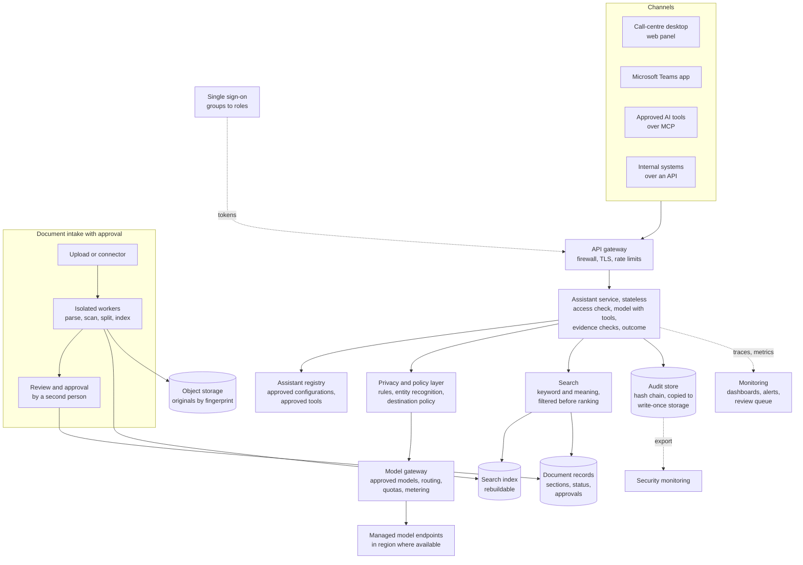
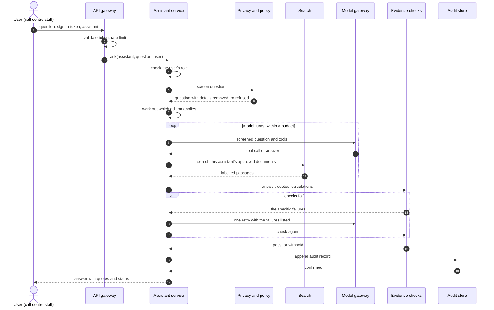
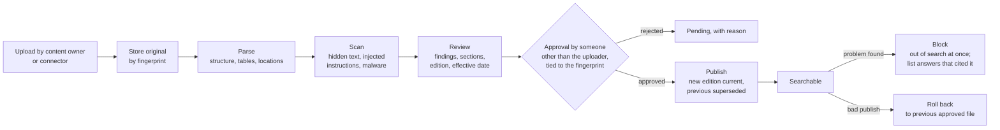

# Kestrel Assistant: production architecture

This is my proposal for taking the prototype into production in a large financial services organisation. [ARCHITECTURE.md](ARCHITECTURE.md) describes what is built and the [README](../README.md) gives the results. Throughout, I keep three things apart:

- **Today**: what the prototype already does, checked against the code.
- **Production adds**: what I would build or buy.
- **Organisation decides**: choices for the business, legal, compliance, security or the Information Officer.

**Vendor facts.** Which models each cloud offers, and which services run in South African regions, change often. I name only well-established services, and every such fact must be confirmed with the provider at design time.

## Summary

**What changes.** The prototype runs on one laptop: a single SQLite database file, a local search index, a user identity read from a settings file, and model calls sent straight to the provider. Production keeps the answering logic as it is: the model searches the approved guides and must quote them word for word, ordinary code checks the quotes and numbers (the "evidence checks"), and the assistant then answers, declines because the guides do not cover the question, or withholds an answer it could not confirm. Production replaces everything around that: a managed database and search, single sign-on, a gateway in front of every model provider, document approval by two people, monitoring with human review, and contracts and sign-offs for personal information.

**Recommended target**, for an organisation already on Microsoft: containers on Azure, Azure Database for PostgreSQL as document record and first search index, Azure API Management as the model gateway, and Entra ID for sign-in. AWS and Google Cloud have equivalents (section 3).

**The three biggest risks.**

1. **A wrong answer that passes the checks.** The checks prove a quote is real and its numbers trace to the source. They cannot prove the sentence reads the quote faithfully: an answer can quote the right passage and drop "working days". Controls: users read the quote, human review of a sample, and evaluation questions that list the conditions an answer must keep.
2. **Personal information reaching a model provider.** Call-centre staff will type member details, removing them by pattern is best effort, and the model may run outside South Africa. Controls: better detection, question text not stored, operator contracts and a decision on where models run.
3. **Out-of-date or wrong guides.** Controls: a named owner for every guide, approval by two people, and withdrawal at once when a guide is wrong.

**Order of work.** First agree owners and the personal-information decisions (stage 0 in section 9), because they decide where the system may run. Then build the platform, run the assistant silently on real questions, pilot it with one supervised team, and expand team by team.

## 1. From prototype to production

The code reaches storage, search, the embedding model (which turns text into numbers so passages can be found by meaning), the privacy screen and the audit log through defined interfaces in `src/kestrel/contracts/`, so each can be replaced without changing the code that uses it.

| Area | Today | Production adds |
|---|---|---|
| Document records | One SQLite file | Managed PostgreSQL on a private network, with point-in-time restore |
| Approval | A file per assistant (`manifest.yaml`) lists approved documents, each tied to the SHA-256 fingerprint of its exact bytes; a changed file drops to "pending" | Originals in locked storage; a review screen; approval by someone other than the uploader |
| Search | Keyword and meaning search, combined; filtered by collection, edition and status before ranking | The same in PostgreSQL (pgvector extension) or a managed search service, plus document permissions; the index is rebuildable from the database |
| Embedding model | `bge-small-en-v1.5`, small, English, local | A larger multilingual model hosted in region |
| Models | One setting picks Anthropic, OpenAI, Ollama Cloud or local Ollama | A gateway all model calls pass through: approved models, quotas, metering, fallback |
| Personal information | Rule-based removal before the model or the log; if screening fails, the question is refused | Entity recognition and measured accuracy (section 6) |
| Where text may go | Destinations tagged on-device or external; a `confidential` assistant may use on-device ones only | The network allows only approved destinations |
| Identity | User and roles from local settings, checked on every call | Single sign-on, directory groups mapped to roles |
| Assistant configuration | A folder per assistant (the code calls it a bot) | A reviewed repository; release only after evaluation passes |
| MCP server (lets other AI tools call the assistant) | Local connection only | Authenticated HTTPS with short-lived tokens |
| Audit log | Each question's outcome, sources, cost and timing; each row includes a hash of the one before, so `kestrel audit verify` detects an edited or deleted row. If the write fails, the answer is still returned | The latest hash copied to write-once storage; no answer returned without a record |

What stays the same: the outcomes (answered, partial, declined, refused for questions outside its remit such as a specific member's claim, and withheld when the checks still fail after one retry), the checks in code, current editions unless a question names another, each assistant's documents kept separate, and no insurance-specific logic in the core code.

## 2. Target architecture



The service keeps no conversation state, so more copies can share the load.

**One question, end to end**



**Document intake**



Today, blocking a document (`kestrel docs block`) and listing the past answers that cited it already work. Production adds the review screen, separate uploader and approver roles and malware scanning.

## 3. Cloud service mapping

Candidate services, all to be confirmed for the chosen region.

| Capability | Azure | AWS | Google Cloud |
|---|---|---|---|
| Containers | Azure Container Apps; AKS | ECS on Fargate; EKS | Cloud Run; GKE |
| PostgreSQL with pgvector | Azure Database for PostgreSQL | Amazon RDS or Aurora PostgreSQL | Cloud SQL for PostgreSQL; AlloyDB |
| Managed search service | Azure AI Search | Amazon OpenSearch Service | Vertex AI Search |
| Object storage with retention lock | Blob Storage, immutability policies | S3 Object Lock | Cloud Storage Bucket Lock |
| Model access | Azure OpenAI and the Azure model catalogue | Amazon Bedrock | Vertex AI |
| API gateway | Azure API Management | Amazon API Gateway | Apigee |
| Identity | Microsoft Entra ID | IAM Identity Center | Cloud Identity |
| Secrets and keys | Azure Key Vault | AWS Secrets Manager; AWS KMS | Secret Manager; Cloud KMS |
| Monitoring | Azure Monitor | Amazon CloudWatch | Cloud Monitoring and Logging |
| Personal information detection | Azure AI Language PII detection | Amazon Comprehend | Sensitive Data Protection |
| Document parsing and OCR | Azure AI Document Intelligence | Amazon Textract | Document AI |

I have deliberately not listed which model families each cloud offers, or where, because that changes month to month. Managed detection services may not recognise South African ID numbers or internal policy numbers, so the prototype's own rules stay.

**Database before search service.** For a few thousand sections I would start with PostgreSQL and pgvector: one store, one backup, one access model, and no gap between what is approved and what is searchable. I would add a search service only when measurements demand it.

### South African data residency

- **Data at rest.** Records, originals, index, audit, logs and backups can stay in South Africa if the chosen cloud offers each service there.
- **Disaster recovery.** If the provider has only one South African region, the choice is redundancy within it or a second region abroad, which is a cross-border transfer and an Information Officer decision.
- **Model inference is the hard part.** Which models can be called from a South African endpoint differs by provider and changes, and some services send requests to other regions for capacity unless that is switched off. If inference runs abroad, the transfer rules in section 6 apply.
- **Organisation decides** what happens if no suitable model runs in the country. My suggestion: `confidential` assistants stay on in-country or self-hosted models (the prototype already limits them to on-device models), and `internal` assistants use an endpoint abroad only with a documented transfer basis, no-retention and no-training terms, and the privacy screen in front.

### Recommended default

For a Microsoft-centred organisation, the Azure column above, with Azure Container Apps (or AKS where that is the standard) and a Teams app as a staff channel. It reuses identity, networking, security operations and procurement the organisation already runs, provided the needed models and services are available in South Africa. Moving to AWS or Google Cloud would replace adapters and infrastructure code, not the answering logic, the checks, the assistant configurations or the evaluation sets.

## 4. Many assistants at scale

Today an assistant is a folder holding its configuration, instructions, approved-documents list and evaluation questions. The repository has two: the product assistant and a staff-policies assistant restricted to a local model. In production:

| Concern | Production |
|---|---|
| Documents | Each assistant has its own collections; documents also carry permission groups, filtered before ranking, so nobody sees a passage they could not open themselves |
| Classification | `public`, `internal` or `confidential`, deciding allowed models and regions, whether question text is stored, and retention |
| Tools from other systems | A register of MCP servers with an owner, a security review and the exact tools allowed. Today `config/mcp_servers.yaml` does this for one read-only demonstration server |
| Cost | Assistant, model, tokens and cost on every audit record, for reporting per business unit |

Likely next assistants (internal policies, an IT help desk, claims procedures) each need documents, configuration, an evaluation set and approvals. Code is needed only for a new kind of tool.

## 5. Security

| Threat | Today | Production adds | What remains |
|---|---|---|---|
| Instructions hidden in documents | Hidden, low-contrast, covered and reversed text removed at intake and recorded; instruction-like wording flagged; no tools that change anything; every claim quoted | A person reviews findings before approval | Visible but misleading text in an approved document |
| Manipulation through the question | Read-only tools; answers limited to quoted approved text | Gateway screening; per-user rate limits | An odd but evidence-backed answer |
| Personal information sent to a provider | Screen before any model call; destination policy; third-party tracing off | In-region endpoints where available; no-retention terms | Unrecognised details in free text |
| One assistant seeing another's documents | Collection on every passage, filtered before ranking; tested | Permission groups; database row-level security | A document put in the wrong collection |
| Misuse of privileges | Role checked on every call; a separate `operator` role for intake, blocking and audit administration | Roles from single sign-on; privileged actions audited | Insider misuse |
| Tampered documents or audit log | Approval tied to the fingerprint; hash chain, which someone able to rewrite the whole file could rebuild | Two-person approval; malware scan; latest hash in write-once storage | Collusion |
| Runaway cost | Per-question limits on model calls, searches, retries and time | Gateway quotas; budget alerts | A burst within quota |
| Compromised dependency | Pinned lockfile | Dependency and image scanning; signed images | A bad release before detection |

Production also keeps the database, index, storage and model endpoints on private networks, encrypts stored data with organisation-managed keys, keeps secrets in the key vault, and gives intake workers no internet access.

## 6. POPIA

This is an engineering view of the Protection of Personal Information Act, not legal advice, and must be confirmed by legal and compliance. The organisation is the responsible party: it decides why and how personal information is processed and stays accountable when a provider does the processing.

**Removing personal information by pattern is best effort.** Today the screen removes valid South African ID numbers and other 13-digit numbers, phone numbers, email addresses, labelled bank, card, policy, member, claim, employee and passport numbers, labelled dates of birth, names after a label or title ("caller name:", "Mr"), and any patterns an operator adds. It misses an unlabelled name ("my client Thandi"), an address, a description of an illness, a number written in words, and any format it has no rule for. Even with entity recognition added, I would assume some details get through, so production should not store question text by default. Today the product assistant stores the screened question for 30 days; the staff-policies assistant stores only a fingerprint of it and refuses questions containing personal details.

**The eight conditions for lawful processing**

| Condition | Today | Organisation must |
|---|---|---|
| Accountability: ensure all conditions are met | Every question, block and unblock logged; each approved document records its approver | Name accountable owners; complete an impact assessment before launch |
| Processing limitation: lawful, minimal, justified | Product questions need no personal information; the screen removes what it can; no access to member or claim systems | Confirm the lawful basis for incidental data; instruct staff not to enter member details |
| Purpose specification: a defined purpose, kept no longer than needed | A stated purpose and retention period per assistant; pruning keeps the audit chain intact | A retention schedule applied to every copy, including backups and provider logs |
| Further processing limitation: reuse must be compatible | Logged questions are not reused for anything | Approve any reuse, such as analytics or model tuning, or forbid it |
| Information quality: accurate and up to date | Only approved, current editions searched; blocked documents never | Content owners keep guides current |
| Openness: tell people what is processed | The app says answers come only from approved documents and that personal information is removed or blocked | Update staff privacy notices |
| Security safeguards | Fail-closed screen, destination policy, separated assistants, hash-chained audit | Section 5 controls; operator contracts; a breach process |
| Data subject participation: access, correction, deletion | Audit records findable by trace id and user | A process covering database, index, logs and backups |

**Special personal information** (sections 26 to 33). Health information may be processed only under stricter conditions, and disability and funeral questions invite it ("is a member with cancer covered?"). The assistant should refuse member-specific medical questions, health terms should be added to the screen, and such questions should not be stored. Whether any authorisation applies is for the Information Officer.

**Operators** (sections 19 to 21). The cloud host, model provider and any managed detection or search service process personal information on the organisation's behalf. Each needs a written contract requiring it to process only as authorised, keep the information confidential, maintain security measures, and report a suspected compromise immediately.

**Transfers outside South Africa** (section 72) are allowed only on a recognised basis, such as a recipient bound by law, binding corporate rules or an agreement giving adequate protection, or consent. Inference abroad, recovery sites abroad and provider support access from abroad all count. Special personal information may also need the Information Regulator's prior authorisation.

**Security compromises** (section 22) must be reported to the Information Regulator and the people affected as soon as reasonably possible.

**Automated decisions.** POPIA restricts decisions with legal or similarly significant effect made solely by automated means. The assistant informs a trained person and refuses member-specific decisions, which keeps it outside that restriction.

**The Information Officer** is responsible for the organisation's compliance and should sign off the impact assessment, processing locations, operator contracts, transfer basis, retention schedule and incident process before real data is processed, with authority to pause the service.

## 7. Quality and monitoring

Each assistant is monitored separately, so a problem in one is not hidden in totals. Measured per assistant and model: outcomes, which checks failed, cost, response time, sections never cited, declined questions (sent to content owners as gaps), and items removed by the screen.

**Example service targets**, to agree with the product owner once the pilot gives a baseline:

| Target | Example |
|---|---|
| Availability in business hours | 99.5% |
| Response time | 95% of answers within 15 seconds |
| Errors | under 1% of requests |
| Withheld answers | under 5% of answerable evaluation questions |
| Search finds the expected section | at least 95% of evaluation questions |
| Blocking takes effect | within 1 minute |

**Alerts** fire on targets at risk, a sharp rise in withheld answers, a fall in search accuracy on a nightly evaluation run, a failed audit verification, and spend at 50%, 80% and 100% of budget.

**Human review.** Reviewers see every flagged or withheld answer and a random sample of the rest (say 2% in the pilot), and judge whether each reads its quotes faithfully, which the code cannot. Confirmed errors become evaluation questions.

**Change control.** Any change to instructions, model, search settings or configuration ships only if the assistant's evaluation meets its thresholds and nothing that passed before now fails. Model versions are pinned at the gateway.

## 8. Cost and scale

```text
cost per question =
    sum over model calls ( input tokens x input price + output tokens x output price )
  + embedding the question
  + share of database or search service
  + share of hosting, gateway and monitoring
  + share of sampled human review time
```

**Measured.** On the 15 test questions the default model, Claude Haiku 5.5, used roughly 12 000 input and 600 output tokens over two or three model calls: about US$0.0015 a question in model charges at list prices on 23 November 2026 (`config/pricing.yaml`). Claude Sonnet 5.5 cost about US$0.027. Production cost will differ with contracted prices, the model chosen, the retry rate and the real mix of questions.

**Capacity, on assumed volumes.** Every volume figure here is an assumption, to be replaced with real call-centre data.

| Assumption | Value |
|---|---|
| Staff using the assistant | 500 |
| Questions per person per day | 20 |
| Working day | 8 hours |
| Busiest hour against the average | 3 times |
| Model calls per question | 3 (measured: two or three) |

That gives 10 000 questions a day and about 1 a second in the busiest hour, which means about 3 model calls a second and roughly 750 000 tokens a minute. The model provider's token quota is therefore the first limit to check; search over a few thousand sections is not a bottleneck. At 4 to 15 seconds an answer, at most about 15 questions are in progress at once, which a few copies of the service handle. Model charges would be about US$15 a day on Claude Haiku 5.5, or US$270 on Claude Sonnet 5.5.

**Savings to try**, each checked against the evaluation: a smaller model for routine questions, escalating when the checks fail; prompt caching of the fixed instructions (the list prices above exclude it); and caching answers to repeated questions, cleared by any publish or block.

## 9. Rollout

| Stage | Entry | What happens | Exit |
|---|---|---|---|
| 0. Approval | Business case; named owners | Impact assessment; operator contracts; security review; current guides approved; 100 or more real, anonymised questions with agreed answers | Information Officer and security sign-off |
| 1. Shadow | Production environment live | The assistant answers real screened questions unseen; reviewers compare its answers with what staff said | Thresholds below met |
| 2. Supervised pilot | Shadow thresholds met | One team of 10 to 20 trained staff, who check the quoted source before giving amounts, deadlines or conditions | Thresholds held for four weeks; time to a checked answer better than the baseline |
| 3. Expansion | Load test and restore drill passed | Further teams, then further assistants, each with its own evaluation set | Targets maintained |

**Roles.** The *product owner* (a call-centre or claims lead) owns scope, go or no-go and benefit measurement. *Content owners* keep each guide accurate and approve each version. The *Information Officer* owns POPIA sign-off, operator and transfer decisions and breach notification. Both can pause the service. *Security* approves models and tools. The *platform team* runs the service, its monitoring, incidents and cost.

**Example go or no-go thresholds**, to agree, reported with sample sizes:

- No confirmed wrong amount, waiting period, deadline or eligibility condition presented as supported in the last two weeks of the stage.
- At least 95% of answerable evaluation questions correct with the material conditions present, and at least 95% of out-of-scope questions declined.
- No raw South African ID number in any stored record.
- The service targets in section 7 met.

**Incidents.** A reported wrong answer is checked against its source: a wrong guide is blocked until corrected; a misreading joins the evaluation set and the fix must pass it. A withdrawn guide is blocked and the list of answers that cited it goes to its owner. Suspected exposure of personal information goes to the Information Officer, who decides on notification. In an outage the assistant says "use the usual process" and never falls back to an unapproved model.

**What would stop the rollout:** an unresolved material wrong answer that the checks and review missed; personal information stored, by us or a provider, against policy; no operator contract or lawful transfer basis for where the model runs; content owners unable to keep guides current; or no measurable time saved once staff check the source.

## 10. Decisions and open questions

| Decision | Why | Revisit when |
|---|---|---|
| PostgreSQL with pgvector as document record and first index | One store, one backup, permission filters in the query, on every cloud | Measured load exceeds it |
| A gateway in front of all models | Quotas, metering, and one place to enforce region and contract terms | The product may change; the gateway stays |
| Evidence checks in code, independent of model and channel | A model change is a measured release, not an act of trust | Not expected |
| Question text not stored by default | Removing personal information is best effort | An approved purpose with a retention period |
| Azure as default for a Microsoft-centred organisation | Reuses identity, network and operations | Needed models or services are not available in South Africa |

**Questions for the organisation**

1. Is model inference outside South Africa acceptable for `internal` assistants, and on what transfer basis? Which models are already approved?
2. Who owns each product guide, and how quickly can they approve a new version or withdraw a wrong one?
3. Which channel comes first: the call-centre desktop, Teams, or an existing knowledge tool?
4. What is today's baseline: time to a checked answer, error rate, escalations?
5. What retention applies to assistant records under the existing schedule?
6. Is there an existing model gateway, detection service or document management system to use?
7. Which other teams want assistants, and with what classification?
8. What budget ceiling and charging model apply per business unit?
